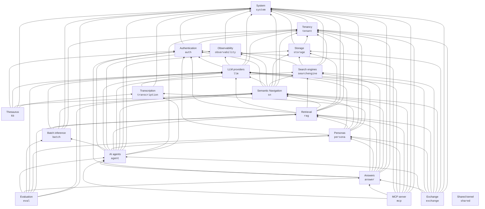

<!-- Generated by TurModuleDocumentationTest from the verified module model; do not edit. Run `mvn test -pl turing-app -Dtest=TurModuleDocumentationTest` to regenerate. -->

# Backend modules

The backend is a modular monolith ([ADR 0005](../adr/0005-modular-monolith-spring-modulith.md)): each direct sub-package of `com.viglet.turing` is a module, and `mvn test` fails on a cycle, a call into another module's internal package or a dependency a module does not declare. The C4 component diagrams and a canvas per module are generated into `turing-app/target/spring-modulith-docs` by the same test.

## Dependencies

An arrow points from a module to one it uses. Every module may use `shared`, so those arrows are left out.

## Modules

| Module | Name | Uses |
|---|---|---|
| `agent` | AI agents | `auth`, `batch`, `llm`, `observability`, `persona`, `rag`, `searchengine`, `shared`, `sn`, `storage`, `system`, `tenant`, `transcription` |
| `answer` | Answers | `agent`, `auth`, `llm`, `persona`, `rag`, `searchengine`, `shared`, `sn`, `system`, `tenant` |
| `auth` | Authentication | `shared`, `system`, `tenant` |
| `batch` | Batch inference | `llm`, `rag`, `sn`, `system`, `tenant` |
| `eval` | Evaluation | `agent`, `answer`, `batch`, `llm`, `persona`, `rag`, `shared`, `sn`, `system` |
| `exchange` | Exchange | `agent`, `answer`, `llm`, `persona`, `rag`, `searchengine`, `sn`, `storage`, `system`, `tenant` |
| `kb` | Thesaurus | `auth`, `llm`, `shared`, `sn`, `system`, `transcription` |
| `llm` | LLM providers | `auth`, `observability`, `shared`, `system`, `tenant` |
| `mcp` | MCP server | `agent`, `answer`, `auth`, `llm`, `persona`, `rag`, `shared`, `sn`, `system`, `tenant` |
| `observability` | Observability | `system` |
| `persona` | Personas | `auth`, `llm`, `rag`, `shared`, `sn`, `system`, `tenant`, `transcription` |
| `rag` | Retrieval | `auth`, `llm`, `searchengine`, `shared`, `sn`, `storage`, `system`, `tenant` |
| `searchengine` | Search engines | `observability`, `shared`, `storage`, `system`, `tenant` |
| `shared` | Shared kernel | nothing |
| `sn` | Semantic Navigation | `auth`, `llm`, `observability`, `searchengine`, `shared`, `storage`, `system`, `tenant` |
| `storage` | Storage | `system`, `tenant` |
| `system` | System | `shared` |
| `tenant` | Tenancy | `shared`, `system` |
| `transcription` | Transcription | `llm`, `shared`, `system` |
