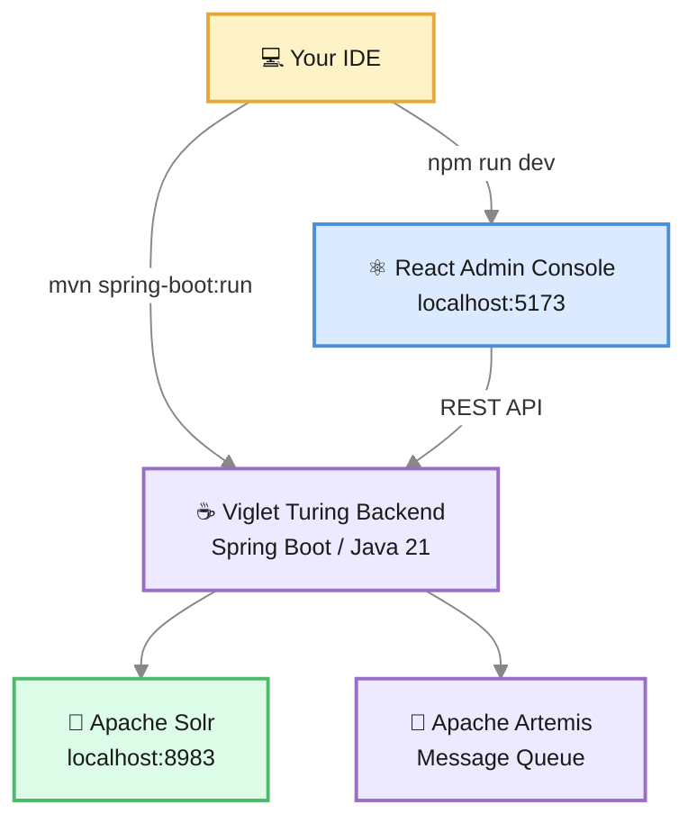
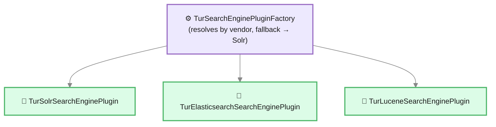

Whether you're **building a search experience** on top of Viglet Turing or **contributing to the project itself**, this guide has everything you need to get up and running quickly.

Viglet Turing is a fully open-source enterprise search platform with semantic navigation and GenAI capabilities. The source code lives at [github.com/openviglet/turing](https://github.com/openviglet/turing) and all contributions are welcome.

---

## Tech stack

Understanding the stack helps you navigate the codebase and decide where to plug in.

| Layer | Technology |
|---|---|
| **Backend** | Java 21 · Spring Boot · Spring AI |
| **Search Engine** | Apache Solr (primary) · Elasticsearch · Lucene |
| **Message Queue** | Apache Artemis |
| **Database** | H2 (dev) · PostgreSQL / MySQL (prod) |
| **Frontend** | React · TypeScript · shadcn/ui · Vite |
| **AI / GenAI** | Spring AI · ChromaDB · PgVector · Milvus |
| **Build** | Maven (backend) · npm (frontend) |
| **CI/CD** | GitHub Actions |



---

## Setting up your dev environment

### Prerequisites

Before you begin, make sure you have these installed:

- [Java 21](https://adoptium.net/temurin/releases/?package=jdk&version=21) (Temurin recommended)
- [Maven 3.9+](https://maven.apache.org/download.cgi)
- [Node.js 20+](https://nodejs.org/en/download/) and npm
- [Git](https://git-scm.com/downloads)
- [Docker Desktop](https://www.docker.com/products/docker-desktop) (for running Solr and other external services locally)

### Clone the repository

```shell
git clone https://github.com/openviglet/turing.git
cd turing
```

### Start Services with Docker Compose

Apache Solr is the only external service required to run Viglet Turing. Apache Artemis runs **embedded** inside the application and requires no separate installation. The easiest way to start Solr locally is with Docker Compose:

```shell
docker-compose up -d
```

This starts:
- **Apache Solr** at `http://localhost:8983`

:::tip
Wait for Solr to be fully ready before starting the backend. You can check at `http://localhost:8983/solr/#/`.
:::

---

## Running Viglet Turing

### Backend (Spring Boot)

Run the full backend including the bundled React console:

```shell
cd turing
mvn spring-boot:run -pl turing-app
```

Or skip the npm build step if you haven't changed the frontend:

```shell
mvn spring-boot:run -pl turing-app -Dskip.npm
```

The backend starts at **`http://localhost:2700`**.

### Frontend: React admin console

For active frontend development, run the React dev server separately. First start the backend in headless mode:

```shell
mvn spring-boot:run -pl turing-app -Dskip.npm -Dspring-boot.run.profiles=dev-ui
```

Then launch the React app:

```shell
cd turing/turing-ui
npm install
npm run dev
```

The Vite dev server starts at **`http://localhost:5173`** with hot-reload enabled.

### Production build

```shell
cd turing
mvn clean install
mvn package -pl turing-app
```

The resulting JAR in `turing-app/target/` bundles both the backend and the compiled React assets.

---

## Development URLs

| Service | URL | Notes |
|---|---|---|
| Admin Console | `http://localhost:2700` | Backend-served |
| React Dev Server | `http://localhost:5173` | Vite hot-reload |
| SN Search Sample | `http://localhost:2700/sn/Sample` | |
| Swagger UI | `http://localhost:2700/swagger-ui.html` | Interactive API docs |
| OpenAPI Spec | `http://localhost:2700/v3/api-docs` | JSON spec |
| Solr | `http://localhost:8983` | Docker Compose |

:::note[Default credentials]
On first startup, set the admin password via the environment variable `TURING_ADMIN_PASSWORD` (minimum 6 characters), or leave it unset and choose the password in the console's first-access setup screen. See [Login](/docs/administration-guide/#login) for details.
:::

---

## Java SDK

The Viglet Turing Java SDK lets you integrate semantic search into any JVM application.

### Run the sample

```shell
cd turing-java-sdk
mvn package
java -cp build/libs/turing-java-sdk-all.jar com.viglet.turing.client.sn.sample.TurSNClientSample
```

### Add to your project via Maven central

Add to your `pom.xml`:

```xml
<dependency>
  <groupId>com.viglet.turing</groupId>
  <artifactId>turing-java-sdk</artifactId>
  <version>2026.2.4</version>
</dependency>
```

The SDK and `turing-commons` are published to [Maven Central](https://central.sonatype.com/search?q=com.viglet.turing). No custom repository configuration is needed.

### Build the SDK

```shell
cd turing-java-sdk
mvn package
```

---

## Database migrations with Liquibase

Viglet Turing uses **[Liquibase](https://www.liquibase.org/)** (v5.0.4) for database schema management. All schema changes (tables, columns, indexes, foreign keys) are tracked as versioned changelogs and applied automatically on startup. This ensures every environment (dev, staging, production) runs the exact same schema, regardless of the database platform.

### How it works

When Viglet Turing starts, Spring Boot runs Liquibase before the application context is fully initialized. Liquibase reads the master changelog, compares it against the `DATABASECHANGELOG` tracking table, and applies any pending changesets. This means:

- **First startup**: the per-module baselines run, creating the full schema from scratch
- **Later startups**: only changesets added since the last startup are applied
- **A database from before the baseline** (one built by a version older than the 2026.3 schema baseline) is refused before anything runs; it is moved by export and import, as [Upgrading to 2026.3](/docs/upgrading/) describes

### Configuration

Liquibase is configured in `application.yaml`:

```yaml
spring:
  liquibase:
    change-log: classpath:db/changelog/db.changelog-master.yaml
    enabled: true
    default-schema: PUBLIC
```

### Changelog structure

Each backend module owns its tables (named `<module>_<entity>`) and keeps its changelogs in its own folder under `turing-app/src/main/resources/db/changelog/`:

```text
db/changelog/
├── db.changelog-master.yaml     ← includes the guard, then each module in layer order
├── baseline-guard.yaml          ← refuses a database built before the baseline
├── system/baseline.yaml
├── tenant/baseline.yaml
├── auth/baseline.yaml
├── ...
├── sn/baseline.yaml
├── ...
└── agent/baseline.yaml
```

A module's `baseline.yaml` holds one changeset per table (the table, its unique constraints and its indexes), then the module's foreign keys, then any seed rows. The master includes the modules from the lowest layer up, so a foreign key always finds the table it points to.

### Writing a new migration

When adding a table, column or index, create a new file in the owning module's folder, named after the release (`v{version}.{n}.yaml`, for example `sn/v2026.3.9.0.yaml`), and add it to the master right after that module's last include.

**Example, adding a column to an existing table:**

```yaml
databaseChangeLog:
  - changeSet:
      id: v2026.3.9.0-add-priority-to-spotlight
      author: viglet-team
      preConditions:
        - onFail: MARK_RAN
        - not:
            - columnExists:
                tableName: sn_site_spotlight
                columnName: priority
      changes:
        - addColumn:
            tableName: sn_site_spotlight
            columns:
              - column:
                  name: priority
                  type: int
                  defaultValueNumeric: 0
```

Key rules:

- **Use lowercase portable types** (`varchar(n)`, `int`, `boolean`, `longtext`, `timestamp`): a unit test refuses database-specific ones such as `CLOB`
- **Always use preconditions** with `onFail: MARK_RAN` so a changeset is safe on a database where the change is already in place
- **Name columns exactly as the entity field** (camelCase maps literally) and tables `<module>_<entity>`
- **Never modify** a changeset that may have run: a fix is a new changeset

### Database platform support

Liquibase abstracts SQL differences across platforms. The same changelogs work on all supported databases; the baselines are tested on H2, MySQL and PostgreSQL:

| Database | Driver | Notes |
|---|---|---|
| **H2** | `org.h2.Driver` | Default for development: embedded, zero setup |
| **MariaDB / MySQL** | `org.mariadb.jdbc.Driver` | Production recommended |
| **PostgreSQL** | `org.postgresql.Driver` | Production recommended |
| **Oracle** | `oracle.jdbc.OracleDriver` | Enterprise environments |
| **SQL Server** | `com.microsoft.sqlserver.jdbc.SQLServerDriver` | Enterprise environments |

Liquibase handles type mappings (e.g., `VARCHAR(255)` on MySQL vs `VARCHAR2(255)` on Oracle) transparently.

---

## Code quality

Viglet Turing maintains high code quality standards. You can check the project health at any time:

| Tool | Link |
|---|---|
| GitHub Actions | [openviglet/turing/actions](https://github.com/openviglet/turing/actions) |
| GitHub Security | [openviglet/turing/security](https://github.com/openviglet/turing/security/code-scanning) |

---

## Search engine plugin architecture

Viglet Turing uses a **plugin architecture** to support multiple search backends behind a unified interface. This abstraction allows the same application code to work with Apache Solr, Elasticsearch, or Lucene: the active plugin is resolved at runtime based on the vendor configured per Search Engine instance.



### The `TurSearchEnginePlugin` interface

All backend operations are defined in a single interface with four categories:

**Search**

| Method | Description |
|---|---|
| `retrieveSearchResults()` | Execute a full-text query and return results with facets |
| `retrieveFacetResults()` | Return facet counts for a query |

**Index management**

| Method | Description |
|---|---|
| `createIndex()` | Create a new core / index |
| `deleteIndex()` | Delete a core / index |
| `clearIndex()` | Remove all documents from a core without deleting it |
| `listIndexes()` | List all cores / indices on the backend |

**Schema management**

| Method | Description |
|---|---|
| `addOrUpdateField()` | Add or update a field definition in the schema |
| `deleteField()` | Remove a field from the schema |
| `fieldExists()` | Check whether a field exists in the schema |

**Documents & monitoring**

| Method | Description |
|---|---|
| `indexDocument()` | Index a single document |
| `deIndex()` | Remove a document from the index |
| `commit()` | Flush pending writes (for backends that require explicit commits) |
| `getDocumentTotal()` | Return the total number of indexed documents |
| `getSystemInfo()` | Return backend version, OS, JVM, and memory information |

### Implementing a new backend

To add support for a new search engine:

1. Create a class implementing `TurSearchEnginePlugin`
2. Implement all methods in the four categories above
3. Register the plugin in `TurSearchEnginePluginFactory` with a vendor identifier
4. The factory resolves the correct plugin based on the `vendor` field of the `TurSEInstance` entity

:::note[Fallback behaviour]
If a vendor is unrecognised or unavailable, `TurSearchEnginePluginFactory` falls back to the **Solr** plugin. Apache Solr is the primary supported backend with the most complete feature set.
:::

---

## REST API

Viglet Turing exposes a REST API for integrating search and AI capabilities into any application. All endpoints use **JSON**. Authentication uses the `Key` header with an API Token created in **Administration → API Tokens**.

For the full endpoint reference (search, autocomplete, spell check, latest searches, GenAI chat, and token usage) see **[REST API Reference](/docs/rest-api/)**.

For interactive exploration, use the built-in Swagger UI at `http://localhost:2700/swagger-ui.html` or the OpenAPI spec at `http://localhost:2700/v3/api-docs`.

---

## Contributing

We'd love your help making Viglet Turing better. Here's how to get involved:

1. **Fork** the [openviglet/turing](https://github.com/openviglet/turing) repository.
2. **Create a branch** for your feature or fix: `git checkout -b feature/my-improvement`
3. **Commit your changes** with clear, descriptive messages.
4. **Open a Pull Request**: describe what you changed and why.

For larger contributions, open an issue first to discuss the approach before writing code.

:::tip
Check the open [GitHub Issues](https://github.com/openviglet/turing/issues) for good first issues tagged with `good first issue` or `help wanted`.
:::

---

## Related pages

| Page | Description |
|---|---|
| [REST API Reference](/docs/rest-api/) | Search, autocomplete, GenAI chat endpoints |
| [GraphQL](/docs/graphql/) | The graph query endpoint |
| [React SDK](/docs/react-sdk/) | Headless hooks + components for custom UIs |
| [Client Tools](/docs/client-tools/) | Building agent↔UI features against the chat SSE |
| [Reference showcase](/docs/showcase/) | A full app built on the SDKs |
| [Architecture Overview](/docs/architecture-overview/) | The system at a glance |


