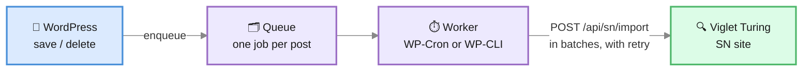

**Viglet Turing Search** (`viglet-turing-search`) is a **PHP plugin installed inside
WordPress**. It sends your content to a Viglet Turing Semantic Navigation (SN) site and
answers your site's search from it.

:::note[No connector process]
The plugin runs entirely inside WordPress and talks to Viglet Turing over HTTP. Unlike the AEM and
Web Crawler connectors, it needs no [Viglet Dumont](https://dumont.viglet.org/) process.
:::

Requires **WordPress 6.6** and **PHP 8.1** or later.

This page is for the WordPress administrator setting the plugin up: what it does, how to
install it and connect it, and how to try it first. The rest of the plugin's documentation:

| Page | What it covers |
|---|---|
| [What the plugin indexes](/docs/integrations/wordpress/indexing/) | Fields and facets, exclusions, PDF files, several sites in one SN site |
| [Search on your site](/docs/integrations/wordpress/search/) | The theme's search, the instant search, the search and Ask this site blocks, the SDK for themes |
| [Manage the plugin in wp-admin](/docs/integrations/wordpress/admin/) | Health, the post list and editor panel, Insights, an exhausted AI budget |
| [Plugin reference](/docs/integrations/wordpress/reference/) | WP-CLI commands, REST routes, constants and filters |
| [Viglet Turing on WordPress](/docs/integrations/wordpress/features/) | Each feature, the block that shows it, and whether it needs a language model |

---

## Watch the demo store

Ana, who runs the Tarnfell demo store, shows what her shoppers see with the plugin: search as
you type, filters from the catalog, cited answers, the shopping copilot and the Site
assistant. The video is in Portuguese; the transcript below has the narration in both
languages. Prefer to click around yourself? [Open the demo store in WordPress
Playground](https://turing.viglet.org/wp-demo/).

[](https://www.youtube.com/watch?v=UVoQXGcd-aI)

<!-- transcript:start (generated by marketing/turing/wordpress/bin/transcript.mjs) -->

<details>
<summary>Transcript (Português)</summary>

Oi! Eu sou a Ana, e essa é a Recanto da Serra, a minha lojinha de aventura. Barracas, jaquetas, botas, tudo pra montanha. A loja roda em WordPress, com o WooCommerce cuidando do catálogo, do carrinho e do pagamento. Agora, vou ser sincera com você: durante anos a caixa de busca foi a parte mais triste da loja. A pessoa digitava alguma coisa, não achava nada e ia embora. Há poucas semanas eu troquei a busca pelo Viglet Turing, e nossa, mudou tudo. Então pega um café, e vem ver o que os meus clientes encontram agora!

Vamos começar por onde todo mundo começa: a página de busca. Sabe aquele momento em que você entra numa loja e não faz ideia do que digitar? Eu perdia tanta gente bem aqui.

Agora olha! As buscas populares dão um ponto de partida. Um toque, e o Viglet Turing traz exatamente os produtos que combinam, junto com os meus guias. Ninguém mais fica olhando pra uma caixa vazia, e sinceramente, só isso já me fez sorrir.

O negócio dos meus clientes é o seguinte: eles não digitam palavras-chave. Eles escrevem do jeito que falam comigo no balcão. Algo como, uma barraca para duas pessoas até dois mil e duzentos reais. A minha busca antiga travava com frases assim.

E olha isso! O Viglet Turing entendeu até dois mil e duzentos reais como um filtro de preço, sozinho, e mostrou só o que cabe no orçamento. E lá em cima, uma resposta curta indicando a melhor, com o preço e o porquê, e todas as fontes logo abaixo. A minha busca antiga do WordPress não achava nada com essa frase. Nada! Agora parece uma amiga que conhece a loja.

E as pessoas fazem perguntas. Daquelas que teriam um pouco de vergonha de fazer numa loja, tipo que mochila eu levo pra uma noite num refúgio. Então elas perguntam pro site.

O Assistente do site responde com base nos meus próprios guias, os que eu escrevi, e cada fonte é um link que dá pra abrir e conferir. É isso que eu mais amo: o Viglet Turing lê o meu site, ele não inventa nada. Parece que eu estou ali, respondendo cada cliente pessoalmente, até de madrugada.

Alguns dos meus produtos se parecem bastante, eu sei. Então as pessoas escolhem alguns e comparam, lado a lado.

A tabela coloca tudo lado a lado, atributo por atributo, e o Viglet Turing escreve um resumo curto a partir dessa mesma tabela, então ele não sai inventando. As diferenças ficam claras na hora. Antes, as pessoas me mandavam e-mail perguntando qual comprar. Agora a própria página conta.

Tá, essa é a minha parte favorita. Sério, a favorita. O cliente nem busca nada. Ele só descreve a viagem, tipo, dois dias atravessando a montanha em julho, primeira vez.

E o Viglet Turing transforma esse plano nas coisas que a pessoa vai precisar, onde dormir, algo pra se aquecer, e preenche cada uma com produtos que eu vendo de verdade, com o preço e o estoque direto da minha loja. Dá pra trocar qualquer item por outro, e com um clique, o kit inteiro vai pro carrinho. Dá pra acreditar? É como ter a minha melhor vendedora em cada página.

Antes de pagar, as pessoas gostam de olhar um produto com mais calma. Justo, eu também faço isso!

Os itens relacionados aparecem logo abaixo, e quando a pessoa faz uma pergunta ali, o Viglet Turing responde sobre aquele produto exato, não sobre outro qualquer, e ainda cita. Isso me mantém seca num dia de chuva? Ele sabe de qual produto ela está falando.

E aí eles finalizam a compra, igualzinho a qualquer loja WooCommerce. Fica tranquilo, isso é uma demonstração, ninguém é cobrado.

O pagamento em si é o mesmo de sempre. O que mudou foi tudo antes dele: a busca e a ajuda trouxeram a pessoa até aqui muito mais rápido.

Agora, a minha comparação favorita: o antes e o depois. À esquerda, a minha antiga busca do WordPress. Alguém digita puffer, e não acha nada. À direita, o Viglet Turing encontra as minhas jaquetas na hora. Mesma loja, mesmos produtos, uma experiência completamente diferente.

E aqui está a minha arma secreta. Cada busca dos meus clientes aparece nos meus insights, inclusive as que não acharam nada. Quando eu vejo uma, transformo num sinônimo com um clique, e a próxima pessoa encontra o que queria. Então a minha loja fica melhor a cada dia, e eu vou aprendendo o que os meus clientes querem de verdade.

Então essa é a Recanto da Serra, com o Viglet Turing! Se você também tem uma loja em WordPress com WooCommerce e está cansado daquela caixinha de busca triste, o plugin e essa demonstração inteira estão no endereço na tela. Vem experimentar, acho que você vai amar tanto quanto eu!

</details>

<details>
<summary>Transcript (English)</summary>

Hi! I'm Ana, and this is Tarnfell, my little outdoor shop. Tents, jackets, boots, everything for the hills, all running on WordPress. Now, I'll be honest with you: for years my search box was the saddest part of the shop. People typed something, got nothing, and left. A few weeks ago I switched the search to Viglet Turing, and oh, it changed everything. So grab a coffee, and let me show you what my customers see now!

Let's start where everyone starts: the search page. You know that moment when you land on a shop and have no idea what to type? I used to lose so many people right here.

Now look! The popular searches give people somewhere to start. One tap, and Viglet Turing brings back exactly the gear that matches, products and my guides together. Nobody is staring at an empty box anymore, and honestly, that alone made me smile.

Here's the thing about my customers: they don't type keywords. They write the way they talk to me at the counter. Something like, a two-person tent under four hundred dollars. My old search choked on sentences like that.

And look at this! Viglet Turing read under four hundred dollars as a price filter, all by itself, and showed only what fits the budget. And up top, a short answer that names the best one, with the price and why, and every source right below it. My old WordPress search found nothing at all for this sentence. Nothing! Now it reads like a friend who knows the shop.

And people ask questions. The kind they'd feel a bit silly asking in a shop, like what size backpack do I need for a night in a hut. So they ask the site instead.

The Site assistant answers from my own guides, the ones I wrote, and every source is a link they can open and check. That's what I love most: Viglet Turing reads my site, it doesn't make things up. It feels like I'm there, answering every customer myself, even at midnight.

Some of my products look a lot alike, I know. So people pick a few and compare them, side by side.

The table lines everything up, attribute by attribute, and Viglet Turing writes a short summary from that very same table, so it never wanders off. The differences are clear at a glance. Before, people emailed me to ask which one to buy. Now the page tells them.

Okay, this is my favourite part. Really, my favourite. A customer doesn't search at all. They just describe their trip, like, two days crossing the mountains in July, first time.

And Viglet Turing turns that plan into the things they'll need, a place to sleep, something warm, and fills each one with gear I really sell, with the price and the stock straight from my shop. They can swap any item for another one, and with one click, the whole kit is in the cart. Can you believe it? It's like having my best salesperson on every page.

Before paying, people like to take a closer look at one product. Fair enough, I do it too!

Related gear shows up right below it, and when they ask a question on that page, Viglet Turing answers about that exact product, not some other one, and it cites it. Will this keep me dry on a wet day? It knows which jacket they mean.

And then they check out, just like in any WooCommerce shop. Don't worry, this is a demo, so nobody is charged.

The checkout itself is the same as always. What changed is everything before it: the search and the help just got them here so much faster.

Now, my favourite comparison: the before and after. On the left, my old WordPress search. Someone types raincoat, and gets nothing. On the right, Viglet Turing finds my rain jackets right away. Same shop, same products, completely different experience.

And here's my secret weapon. Every search my customers make shows up in my insights, including the ones that found nothing. When I see one, I turn it into a synonym with a single click, and the next person finds what they wanted. So my shop keeps getting better, every single day, and I'm learning what my customers really want.

So that's Tarnfell, with Viglet Turing! If you run a WordPress shop too, and you're tired of that sad little search box, the plugin and this whole demo are at the address on screen. Come and try it, I think you're going to love it as much as I do!

</details>

<!-- transcript:end -->

---

## How it works



- **Saving a post never calls Viglet Turing.** Publishing, updating, unpublishing, trashing or
  deleting a post only queues one job for it; saving again replaces that job, so the last
  save wins.
- **A worker sends the queue** in batches through WP-Cron, or through
  `wp turing queue run` on hosts that disable WP-Cron. When Viglet Turing is unreachable, a job
  backs off (1 minute, doubling, up to an hour). After 8 failed attempts, about three hours,
  it stops retrying. Every admin screen then warns that edits have not reached search, with
  a link to **Search health**. The worker asks Viglet Turing every 15 minutes whether it is back,
  and once a ping or any send goes through, the stopped edits go back in line with no click.
  A job is put back at most three times, so a document Viglet Turing keeps refusing stops for good
  and waits for **Retry** on Search health. A post Viglet Turing refuses is retried on its own, so
  one bad post does not block the rest of its batch.
- **Each post records its state**: when it was last indexed, its last error and its
  failed attempts. The post lists and the block editor show it (see [the post list and the editor](/docs/integrations/wordpress/admin/#the-post-list-and-the-editor)).
- **Index All runs in the background.** The button under **Settings → Actions**, and
  **Index everything now** on **Setup**, only start the reindex; WP-Cron sends it a few
  batches at a time, so you can close the page as soon as it starts. A batch Viglet Turing does
  not take is tried again after a wait (30 seconds, doubling, up to 10 minutes); after five
  tries its posts count as failed and the reindex goes on with the next batch. A reindex of
  all content then sends every PDF and sweeps, like `wp turing reindex`, and skips the
  sweep when any post failed. **Search health** shows its progress, has **Cancel reindex**,
  and shows how the last one ended. It does not need visitors: after each step the site
  asks itself for the next one (a background request to its own
  `viglet-turing/v1/reindex/step`, signed with a token only the running reindex knows), so
  a started reindex finishes on a site nobody visits. Where the server cannot reach its own
  address, such as a container behind a mapped port, point the request at one it can with
  the `viglet_turing_reindex_step_url` [filter](/docs/integrations/wordpress/reference/#filters), as `cron_request` does for WP-Cron. While
  **Search health** is open it also takes a step whenever the reindex has sat idle for 15
  seconds, which covers a host that blocks those requests. A batch waiting out a retry
  after Viglet Turing failed resumes on the next WP-Cron run or the next step from Search health.
---

## Install

**From wp-admin**: download `viglet-turing-search-<version>.zip` from the
[Viglet Turing releases](https://github.com/openviglet/turing/releases) (the tags
`wordpress-v<version>`, beside Viglet Turing's own) and upload it under
**Plugins → Add New → Upload Plugin**.

**With Composer**, for a site built in CI or running with `DISALLOW_FILE_MODS`: declare the
release zip as a package, and `composer/installers` puts it in the plugins directory.

```json
{
    "repositories": [
        {
            "type": "package",
            "package": {
                "name": "viglet/turing-wordpress",
                "version": "1.0.0",
                "type": "wordpress-plugin",
                "dist": {
                    "type": "zip",
                    "url": "https://github.com/openviglet/turing/releases/download/wordpress-v1.0.0/viglet-turing-search-1.0.0.zip"
                },
                "require": { "composer/installers": "^2.0" }
            }
        }
    ],
    "require": { "viglet/turing-wordpress": "1.0.0" }
}
```

**With WP-CLI**: `wp plugin install <zip URL> --activate`.

Then open **Viglet Turing Search → Setup**.
---

## Connect to Viglet Turing


**Viglet Turing Search → Setup** takes the connection, then **Save and test the connection** checks
it one step at a time and stops at the first failure, naming it:

| Step | Fails when |
|---|---|
| Address | The URL is not a full `http://` or `https://` address |
| Network | The host does not resolve (DNS), the certificate is rejected (TLS), nothing answers in time, or nothing listens on that port |
| Viglet Turing | The server answers, but not with Viglet Turing's discovery document (wrong URL, or a proxy in the way) |
| API key | No key is set, or Viglet Turing refuses it (wrong, expired, or its user cannot manage SN sites) |
| SN site | No SN site has that name yet; the page offers **Create the SN site** |

Once every step passes, **Index everything now** runs the first index with a progress bar.

| Setting | Meaning |
|---|---|
| **Viglet Turing URL** | Viglet Turing as this server reaches it, e.g. `https://search.example.org` |
| **API key** | A Viglet Turing API token (Viglet Turing console → API Tokens). It is never shown again after saving |
| **SN site** | The Semantic Navigation site this WordPress publishes to and searches |
| **Locale** | The language the content is indexed in, e.g. `pt_BR` |
| **Site key** | Starts every document id; see [Several sites, one SN site](/docs/integrations/wordpress/indexing/#several-sites-one-sn-site) |

In [WordPress Playground](https://wordpress.org/playground/), WordPress runs in the
visitor's browser and so do its requests to Viglet Turing: the blueprint needs
`features.networking` on, and Viglet Turing has to be on a public address. A public Viglet Turing is
reached directly when its `turing.allowedOrigins` includes `https://playground.wordpress.net`,
and through Playground's own proxy when it does not. One on a private address, such as
`http://localhost:2700`, cannot be reached from there at all, and the connection check says
so at the **Network** step rather than reporting an HTTP error.

### From the environment

A container deploy can set the connection with no wp-admin step. Each of these is read
from a `wp-config.php` constant or, failing that, an environment variable of the same name.
A value set either way wins over the settings page, shows there read-only, and is
**never written to the database**, so the API key stays out of database backups.

| Name | Setting |
|---|---|
| `VIGLET_TURING_TURING_URL` | Viglet Turing URL, as this server reaches it |
| `VIGLET_TURING_TURING_SITE` | SN site |
| `VIGLET_TURING_TURING_API_KEY` | API key |
| `VIGLET_TURING_TURING_LOCALE` | Locale |
| `VIGLET_TURING_SITE_KEY` | Site key |
| `VIGLET_TURING_PUBLIC_URL` | Viglet Turing as visitors' browsers reach it, when that differs |
| `VIGLET_TURING_SEARCH_URL` | A results page on another site that this site's searches go to |
| `VIGLET_TURING_SEARCH_SITE_KEYS` | The other sites this site [also searches](/docs/integrations/wordpress/indexing/#searching-other-sites-too): `key \| label \| address` entries separated by commas or new lines, or a JSON list of `{key, label, url}` |

`wp turing status` prints where each value came from.

### Demo mode

`VIGLET_TURING_DEMO=1`, as a constant or an environment variable, is for a site whose
wp-admin belongs to whoever opens it, such as a demo in WordPress Playground. The site then
holds no API key and never writes to Viglet Turing: saving a post queues nothing, the indexing
buttons say demo mode is on, and **Search tuning** and **Search insights** are hidden,
because their Viglet Turing endpoints need a key. Search, chat, the copilot and answers keep working
from the visitors' browsers against a **PUBLIC** SN site whose index is built elsewhere, and
the connection check confirms that site with a search sent without a key. It cannot be
turned off from wp-admin.

---

## Try it in your browser

[Open the demo store in WordPress Playground](https://playground.wordpress.net/?blueprint-url=https%3A%2F%2Fturing.viglet.org%2Fplayground%2Fblueprint.json).
WordPress, WooCommerce, the plugin and the Tarnfell store start in your browser, with nothing
to install, and search a hosted Viglet Turing. The first load takes two or three minutes
while the catalog is created. The plugin runs in demo mode: it reads the hosted index and
never writes to it, so the Search tuning and Search insights screens are hidden.
Every feature is marked with its chapter in the shopper's story, and nothing you do is kept:
a reload starts the store again.

## Try it locally

The plugin's source, [`wordpress/`](https://github.com/openviglet/turing/tree/2026.3/wordpress)
in the Viglet Turing repository, has a Docker stack for trying it end to end. `run-docker.cmd`
starts WordPress, MariaDB, a WP-Cron runner and a local Viglet Turing, creates the SN site, gives
the plugin an API key, and builds the admin screens. WordPress is then at
`http://localhost:8080` and Viglet Turing at `http://localhost:2700`.

`run-docker.cmd demo` also starts the two demo stores, side by side: Tarnfell, a WooCommerce
shop with its own catalog, buying guides and SN site at `http://localhost:38082`, and the same
store in Portuguese and in reais, Recanto da Serra, at `http://localhost:38083`
(`run-docker.cmd demo en` or `demo pt` starts one). Its `/showcase/` page holds
every Viglet Turing block, and `?tour=1` on any of its pages marks each feature with its chapter in
the [shopper's story](https://github.com/openviglet/turing/blob/2026.3/wordpress/demo/story.md)
that the [WordPress page](https://turing.viglet.org/wordpress/) walks through. Set `OPENAI_API_KEY` before
starting it to turn on the answers, the catalog copilot and the Site assistant; without it
they stay hidden. On Linux and macOS, `sh bin/run-docker.sh demo` does the same (it
provisions Viglet Turing through PowerShell, `pwsh`), and `demo reset en` or `demo reset pt` deletes
one store's WordPress and database, leaving the other as it was.

`run-docker.cmd demo edu` starts a demo school beside the stores: Lumen School at
`http://localhost:38085`, or Escola Lumen in Portuguese at `http://localhost:38086` with
`demo edu-pt`. It has no WooCommerce: it puts the plugin's features for a site that is not a
store together on one site. Its **Agenda** page is a search block fixed to events. The event's
day filters by **Today**, **Next 7 days**, **This month**, **Upcoming** and **Past**, and a
search like `debates in December` is read as that month. Each event's card shows the day it
happens and its poster. An opening leaves search the day after it closes, and the **Library**
finds a book by a sentence inside its sample chapter, a PDF. Every date is counted from the day
the school is set up, so the agenda is never stale. The
[school's story](https://github.com/openviglet/turing/blob/2026.3/wordpress/demo/school/story.md)
walks it, and `npm run test:e2e:edu` runs its browser tests. Each demo site, store or school, is
described by one file in `demo/sites/`, which the scripts and the browser tests read.
