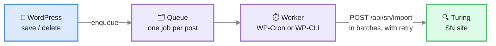

**Viglet Turing Search** (`viglet-turing-search`) is a **PHP plugin installed inside
WordPress**. It sends your content to a Viglet Turing Semantic Navigation (SN) site and
answers your site's search from it.

:::note[No connector process]
The plugin runs entirely inside WordPress and talks to Turing over HTTP. Unlike the AEM and
Web Crawler connectors, it needs no [Dumont](https://dumont.viglet.org/) process.
:::

Requires **WordPress 6.6** and **PHP 8.1** or later.

---

## How it works



- **Saving a post never calls Turing.** Publishing, updating, unpublishing, trashing or
  deleting a post only queues one job for it; saving again replaces that job, so the last
  save wins.
- **A worker sends the queue** in batches through WP-Cron, or through
  `wp turing queue run` on hosts that disable WP-Cron. When Turing is unreachable, a job
  backs off (1 minute, doubling, up to an hour). After 8 failed attempts, about three hours,
  it stops retrying. Every admin screen then warns that edits have not reached search, with
  a link to **Search health**. The worker asks Turing every 15 minutes whether it is back,
  and once a ping or any send goes through, the stopped edits go back in line with no click.
  A job is put back at most three times, so a document Turing keeps refusing stops for good
  and waits for **Retry** on Search health. A post Turing refuses is retried on its own, so
  one bad post does not block the rest of its batch.
- **Each post records its state**: when it was last indexed, its last error and its
  failed attempts. The post lists and the block editor show it (see [Admin](#admin)).
- **Index All runs in the background.** The button under **Settings → Actions**, and
  **Index everything now** on **Setup**, only start the reindex; WP-Cron sends it a few
  batches at a time, so you can close the page as soon as it starts. A batch Turing does
  not take is tried again after a wait (30 seconds, doubling, up to 10 minutes); after five
  tries its posts count as failed and the reindex goes on with the next batch. A reindex of
  all content then sends every PDF and sweeps, like `wp turing reindex`, and skips the
  sweep when any post failed. **Search health** shows its progress, has **Cancel reindex**,
  and shows how the last one ended. It does not need visitors: after each step the site
  asks itself for the next one (a background request to its own
  `viglet-turing/v1/reindex/step`, signed with a token only the running reindex knows), so
  a started reindex finishes on a site nobody visits. Where the server cannot reach its own
  address, such as a container behind a mapped port, point the request at one it can with
  the `viglet_turing_reindex_step_url` filter, as `cron_request` does for WP-Cron. While
  **Search health** is open it also takes a step whenever the reindex has sat idle for 15
  seconds, which covers a host that blocks those requests. A batch waiting out a retry
  after Turing failed resumes on the next WP-Cron run or the next step from Search health.

---

## Install

**From wp-admin**: download `viglet-turing-search-<version>.zip` from the
[Dumont releases](https://github.com/openviglet/dumont/releases) (tags
`wordpress-v<version>`) and upload it under **Plugins → Add New → Upload Plugin**.

**With Composer**, for a site built in CI or running with `DISALLOW_FILE_MODS`: declare the
release zip as a package, and `composer/installers` puts it in the plugins directory.

```json
{
    "repositories": [
        {
            "type": "package",
            "package": {
                "name": "viglet/turing-wordpress",
                "version": "1.0.0",
                "type": "wordpress-plugin",
                "dist": {
                    "type": "zip",
                    "url": "https://github.com/openviglet/dumont/releases/download/wordpress-v1.0.0/viglet-turing-search-1.0.0.zip"
                },
                "require": { "composer/installers": "^2.0" }
            }
        }
    ],
    "require": { "viglet/turing-wordpress": "1.0.0" }
}
```

**With WP-CLI**: `wp plugin install <zip URL> --activate`.

Then open **Viglet Turing Search → Setup**.

---

## Connect to Turing


**Viglet Turing Search → Setup** takes the connection, then **Save and test the connection** checks
it one step at a time and stops at the first failure, naming it:

| Step | Fails when |
|---|---|
| Address | The URL is not a full `http://` or `https://` address |
| Network | The host does not resolve (DNS), the certificate is rejected (TLS), nothing answers in time, or nothing listens on that port |
| Turing | The server answers, but not with Turing's discovery document (wrong URL, or a proxy in the way) |
| API key | No key is set, or Turing refuses it (wrong, expired, or its user cannot manage SN sites) |
| SN site | No SN site has that name yet; the page offers **Create the SN site** |

Once every step passes, **Index everything now** runs the first index with a progress bar.

| Setting | Meaning |
|---|---|
| **Turing URL** | Turing as this server reaches it, e.g. `https://search.example.org` |
| **API key** | A Turing API token (Turing console → API Tokens). It is never shown again after saving |
| **SN site** | The Semantic Navigation site this WordPress publishes to and searches |
| **Locale** | The language the content is indexed in, e.g. `pt_BR` |
| **Site key** | Starts every document id; see [Several sites, one SN site](#several-sites-one-sn-site) |

In [WordPress Playground](https://wordpress.org/playground/), WordPress runs in the
visitor's browser and so do its requests to Turing: the blueprint needs
`features.networking` on, and Turing has to be on a public address. A public Turing is
reached directly when its `turing.allowedOrigins` includes `https://playground.wordpress.net`,
and through Playground's own proxy when it does not. One on a private address, such as
`http://localhost:2700`, cannot be reached from there at all, and the connection check says
so at the **Network** step rather than reporting an HTTP error.

### From the environment

A container deploy can set the connection with no wp-admin step. Each of these is read
from a `wp-config.php` constant or, failing that, an environment variable of the same name.
A value set either way wins over the settings page, shows there read-only, and is
**never written to the database**, so the API key stays out of database backups.

| Name | Setting |
|---|---|
| `VIGLET_TURING_TURING_URL` | Turing URL, as this server reaches it |
| `VIGLET_TURING_TURING_SITE` | SN site |
| `VIGLET_TURING_TURING_API_KEY` | API key |
| `VIGLET_TURING_TURING_LOCALE` | Locale |
| `VIGLET_TURING_SITE_KEY` | Site key |
| `VIGLET_TURING_PUBLIC_URL` | Turing as visitors' browsers reach it, when that differs |
| `VIGLET_TURING_SEARCH_URL` | A results page on another site that this site's searches go to |
| `VIGLET_TURING_SEARCH_SITE_KEYS` | The other sites this site [also searches](#searching-other-sites-too): `key \| label \| address` entries separated by commas or new lines, or a JSON list of `{key, label, url}` |

`wp turing status` prints where each value came from.

### Demo mode

`VIGLET_TURING_DEMO=1`, as a constant or an environment variable, is for a site whose
wp-admin belongs to whoever opens it, such as a demo in WordPress Playground. The site then
holds no API key and never writes to Turing: saving a post queues nothing, the indexing
buttons say demo mode is on, and **Search tuning** and **Search insights** are hidden,
because their Turing endpoints need a key. Search, chat, the copilot and answers keep working
from the visitors' browsers against a **PUBLIC** SN site whose index is built elsewhere, and
the connection check confirms that site with a search sent without a key. It cannot be
turned off from wp-admin.

---

## What gets indexed

Every post sends a fixed document: `id`, `title`, `text` (the rendered body without
markup, shortcodes or hidden UI text), `abstract`, `url`, `type`, `author`,
`publication_date`, `modification_date`, `site`, `image`, `site_key`, `source_apps`, plus
`categories` / `section` and `tags` when those options are on. Approved comments and named
custom fields can be added on the Settings page.

### Fields and facets


**Viglet Turing Search → Fields** maps, per post type, what else becomes its own Turing field:

- **Source**: a taxonomy, a meta key the posts actually carry, a post field (excerpt,
  slug, menu order, parent) or the featured image URL.
- **Type**: `STRING`, `TEXT`, `INT`, `LONG`, `FLOAT`, `DOUBLE`, `DATE` or `BOOL`. A value
  that does not convert is left out, never guessed. Dates are read as `Ymd` (ACF), a Unix
  timestamp, or any date `strtotime` reads.
- **Multiple**, **Facet** with its label, and a **Weight** (1 to 100) for ranking.
- **Ranges**, on a `DATE` or number field: a range facet as well, provisioned as a Turing
  custom facet named `<field>_range`. A date picks its **Periods**: **Past**, for
  publication dates (upcoming, last 7 days, last 30 days, this year, before this year);
  **Agenda**, for dates still to come (today, next 7 days, this month, upcoming, past); or
  **My own**, up to eight, each bound in Turing's date math (`NOW/DAY`, `NOW/DAY+7DAYS`,
  `2026-12-01`). Turing's date math has no weeks, so an agenda offers the next 7 days rather
  than the calendar week. Turing includes a range's end, and a day-only date is stored at
  midnight UTC, so each agenda period ends a second before the next one starts: an event
  today is never under **Past**, and one tomorrow is never under **Today**. A period of your
  own that should end where another starts needs the same `-1SECOND`. A period buckets the one field, so an event is placed by its start
  date even when it runs for weeks. A number lists its own ranges, each with a label
  and a **From** and **To**; an empty bound is an open end, and an empty label is written
  from the bounds ("20 – 50", "Up to 20", "50 or more").
- **Show on result cards** adds the field to each result in the **Turing search** block,
  as a "Label: value" line under the snippet, in the order of the fields. The label is the
  field's label, or its name when it has none. A `DATE` field is written in the site's date
  format, a multiple field's values are joined with commas, and a URL is never shown as
  text. An event, say, can show the day it happens beside the day it was posted.
- **Date shown on cards** and **Image on cards**, per post type: the card's date can be one
  of the type's `DATE` fields instead of the publication date, and its image one of its
  text fields (an image URL) instead of the featured image. An event's card then shows the
  day it happens. A date with no time of day is shown as that day in every time zone. The
  instant search shows the same date, and the first card field, under each result.
- **Leave this type out of search** switches a whole post type off.
- **Types from other sources** lists the types of documents another source sent under the
  site key, such as a catalog's `Article` or `Thesis`, which no post type has. Each one
  gets a **Label** (its badge on result cards), a **Date shown on cards** from the date
  fields its documents carry (`defense_date`, say) and an **Image on cards** from their
  text fields. This changes how they look, never what is indexed. A record with several
  types, `["Article", "Thesis"]`, is shown as its first. The section appears once Turing
  holds such a document. The screen asks Turing for the other sources' documents only,
  leaving the plugin's own posts out with a negative filter, so however many posts the site
  has, the first 2,000 records from other sources are what it reads. This needs a Turing that
  honours a negative filter (2026.3 builds after T1233); an older one also returns the posts,
  which the screen skips.

**In Turing** says where each field stands: *In Turing*, *Added on the next save*, or
*Conflict* when Turing already holds the field with another type. **Preview document**
shows the JSON the newest post of the type sends. **Save and send to Turing** stores the
mapping and provisions the fields through Turing's manifest API, so facets need no console
step. Run a reindex afterwards so existing posts carry the new fields.

With nothing configured, every public custom taxonomy is mapped as a facet.

**People, organisations and places.** Names live in a post's text, not in its fields, so no
mapping can reach them. Turn on **Settings → Search → Generative AI → Find people,
organisations and places in posts** and Turing's language model reads each post as it is
indexed and lists the people, organisations and places it names. Turing keeps a name only
when the text holds it, and writes it to one of three facet fields: `entity_person`,
`entity_organization` and `entity_place`. The section of that name on the **Fields** screen
gives each one its facet label (*People*, *Organisations*, *Places* by default) and an
**Offered** box. The **Turing search** block then offers the ones you keep as facets beside
the others, under those labels, and its filter chips use them too.

- It needs **Generative AI** on as well: the names are found by the language model of the
  site's AI agent in Turing (its Default AI Agent, unless one was chosen in Turing's console).
  With generative AI off, nothing is asked and the facets are not offered. The Fields section
  says which setting is missing.
- Each post indexed is a call to the language model, counted in the site's AI spend in Turing.
  Turing keeps what it found in memory by text, so a post re-sent unchanged is not read again
  while Turing still holds it.
- The setting goes to Turing with the fields: on the next indexing run, or when the Fields
  screen is saved. Posts indexed before get their names once they are reindexed. Turning it
  off here tells Turing to stop, as long as generative AI is still on.
- If the model fails, the post is indexed without names.

**Name variants** (same Settings card) folds the ways a name is written into one facet value.
Write one name per line, the name to show first and then its variants after a `|`, separated
by `;`:

```text
Marta Vilar | Vilar, Marta; M. Vilar
Fundação Aurora | Aurora
```

Saving sends them to Turing's Thesaurus, in a thesaurus of the plugin's own named after the site
key, selected for the SN site. A post that writes *Vilar, Marta* is then listed under *Marta
Vilar*. Settings shows how many names were saved, or why Turing refused them. An API key bound to
a partition of a shared SN site cannot write the Thesaurus, so on such a key add the names in
Turing's Thesaurus instead. Posts already indexed follow once reindexed.

**WooCommerce.** With WooCommerce active and `product` among the indexed types, a product
offers its shop fields as sources: **Product: Price**, **Regular price**, **Sale price**,
**Stock status**, **SKU** and **Average rating**. With nothing configured a product sends
its price, its stock as a **Stock** facet (in the shop's words, "In stock"), its product
categories and tags, and each global attribute (`pa_color`, ...) as a facet. Turn on
**Ranges** for the price to filter by "Up to 50", "50 – 100" and so on. A product whose
stock changes from an order is sent again, although no post was saved, and so is a variable
product when one of its variations changes.

In the **Turing search** block a product's result shows its price in the shop's currency
(the regular price struck through when it is on sale) and an **Add to cart** button. It
adds one through WooCommerce's Store API without leaving the page, and says whether it
worked, with WooCommerce's reason when it did not (out of stock, say). A variable product
(one sold in colours or sizes) is indexed once, with its variations' values as facet values,
and **Add to cart** here, in the catalog copilot and in a kit puts in its first variation the
shop can sell.

The same mapping is readable and writable as JSON at `viglet-turing/v1/mapping`. A theme
can map in code with the `viglet_turing_mapping` filter, and change a document just before
it is sent with `viglet_turing_document`. `viglet_turing_result_card` changes a result card
the search block draws on the server, before its script runs (`$card`, `$document`). The
script redraws a card from the mapping alone, so use the filter only for what Fields can't
set, or the card changes once the page loads.

### Excluding content

A post is left out when its type is off, when its ID is in **Exclude Posts/Pages**
(Settings), or when **Exclude from search** is on in its editor panel
(`_viglet_turing_exclude` meta).

A post can also leave search on a date: in **Fields**, **Leaves search on** picks one of
the type's `DATE` fields (a job opening's last day to apply, say). Once that date has passed
the post is taken out of search, at that moment, with no one saving it. A date with no time
of day lasts to the end of that day. Move the date forward and save, and the post is back.
The editor panel says when a post leaves search, and **Out of search: the date has passed**
afterwards. `wp turing sweep` applies the same rule.

For a rule no field can express, the `viglet_turing_should_index` filter (`$index`,
`$post`) has the last word on whether a post is in search.

### PDF files

With **PDF files attached to them** on (Settings → Content), each PDF in the media library
that a post in search attaches or links is a document of its own, found by the words
inside it. A link counts when the post's content points at the PDF's address in this
site's uploads, so a form uploaded once and linked from several pages is found even though
no page attached it. The plugin sends the file with the document, and Turing reads its
text. A PDF shows as **PDF** in the type badge and facet, with its post as its section. It
is sent when uploaded or edited, when a post in search first attaches or links it, and on
**Index All**. It is removed when the attachment is deleted, and when no post in search
holds it any more: the last post that attaches or links it is unpublished, excluded,
deleted or past its **Leaves search on** date, or stops linking it. A PDF another post in
search still links stays. Only this site's own uploads are sent, up to 20 MB each (the
`viglet_turing_pdf_max_bytes` filter changes the cap); a link to a file on another host is
never followed.

A post can also carry a PDF's words in its own document. In **Fields**, the source **Text
of the PDF in meta: `<key>`** reads the PDF a meta names, by this site's upload address or
by attachment ID, into a `TEXT` field of the post. A search for a sentence in the paper
then finds the post itself. This works whether or not **PDF files attached to them** is on,
and a file on another host is never fetched.

---

## Several sites, one SN site

Document ids are `<site key>:post:<post ID>`, and every document carries a `site_key`
field, provisioned as a facet. Several WordPress sites (or the blogs of a multisite
network) can therefore publish into one SN site for a unified search, without replacing
each other's documents. The key defaults to the site's host and path
(`example.org-projetos`); set it in Setup or with `VIGLET_TURING_SITE_KEY`.

**Delete All** and `wp turing sweep` remove only this key's documents, and only the ones the
plugin sent. A Dumont connector given the same site key, such as a catalog of theses that
should come up in the site's search, keeps its documents through Index All, the sweep and
Delete All. **Search health** says how many documents under the key came from another source.
Their types get a label, a card date and a card image under **Fields → Types from other
sources**.

A post and an archive record use the same field for the author, the date and the snippet:
Turing's own `author`, `publication_date` and `abstract`, which the
[catalog connector](https://dumont.viglet.org/docs/connectors/catalog/) sends for OAI-PMH and DSpace records
too. So a thesis and a post by the same person share one author facet value, and both show
a date and a snippet on their cards. The plugin declares `author` with several values, for a
thesis's co-authors. A site provisioned by an older version, where `author` held one value,
is converted the next time the fields are sent to Turing (Turing recreates the field), so
run **Index All** afterwards.

### A key per site

A plain API key reaches every document in the SN site, so one site's key could read or
delete another's. Instead, give each site its own key bound to its site key. In the Turing
console, under **Administration → API Tokens**, set **Partition of a shared site** to the
field `site_key` and this site's key as the value. Then paste the token into this site's
Setup. Turing then keeps the key inside the site's own documents. Some things are shared by
every site of the SN site, so this key cannot change them:

| What | With a key bound to the site |
|---|---|
| Fields | Saving fields that would change the SN site's schema is refused, and the Fields screen and Health show Turing's reason. Add or change fields with a key that has no partition |
| Boosts | Off. The Search tuning screen says why |
| Synonyms | Listed, but adding or removing one is refused, because every site shares the synonyms |
| Promoted results | Each site sees, adds and removes only its own, and they show only in its own searches |

Health's AI features check works with either key. On a multisite network, don't set
`VIGLET_TURING_TURING_API_KEY`: a constant applies to every blog and overrides each blog's
own key.

### Searching other sites too

Each site searches only its own key by default. To have a site also find what other sites
publish into the same SN site, list them in **Settings → Connection → Also search these
sites**, one per line: the other site's key, then optionally a label and its address,
separated by `|`:

```text
second-site | Second site | https://second.example.org/
library | The library
```

`VIGLET_TURING_SEARCH_SITE_KEYS` sets the same list from outside WordPress. Keys are cleaned up
the way the **Site key** is. A blank key, a key listed twice, or this site's own key is left out.
A label defaults to the key, and an address other than `http` or `https` is dropped.

With sites listed, every search here reads this site's key and theirs: the **Turing search**
block, the theme's search page, the plugin's results page, the instant search, the editor's
preview and the check behind the popular-search chips. A result from another site:

- links to that site's own address, never to a page here;
- carries its site's label: as a badge on the block's cards and the results page, and in the
  instant search's line under the title. On the theme's search page it uses the theme's
  markup, so it shows as the theme shows any post, without a badge;
- adds a **Site** facet to the block and the results page, one value per site by its label,
  so a visitor can narrow to one site and back.

The generative features (**Ask the catalog**, **Build my kit**, the **Site assistant** and
the filters read from a sentence) send every listed key, so they cite those sites' documents
too. The assistant may open a page on a listed site only when its address is given.

The **Related content** block stays on this site's posts unless its **Include the sites this
one also searches** setting is on. With it on, the other sites' documents appear with their
title, their site's label and a link to their own site, asked of Turing inside the same
scope the search uses, so the nearest posts across those sites come first. This needs a
Turing whose similar-documents search reads the site keys as alternatives (2026.3 builds
after T1235). The automatic placement after content keeps the default.

The list is one-way: a site you list does not find this one's documents unless it lists this
site too. Writing never reaches another site's documents. Index All, the sweep, **Delete All**,
the counts on **Search health**, **Search tuning** and **Already covered?** in the editor all
work on this site's key alone.

A [key bound to the site](#a-key-per-site) reads only its own site's documents, so searches
across sites are sent without the key, the way a visitor's browser sends them. Search in Turing
is public, so this exposes nothing new.

:::note[Two values in one facet]
Turing combines two values of one field as alternatives only when the request asks for that,
and the request can ask it only for every field at once (`fqi.op=OR`). So while other sites are
listed, two values a visitor picks in the same facet also become alternatives (either one)
rather than both. Filters on different facets still all apply.
:::

### A site whose search lives on another site

A site that indexes into the shared SN site but has no results page of its own can send
its searches to another site's page. In **Settings → Search**, set **Results page on
another site** to that page's address (or set `VIGLET_TURING_SEARCH_URL`). Then Enter in
the instant search, a search block with no results part and the theme's search box all
open that page with the query, as `?q=`, or as `?s=` when the address you set ends in
`?s=`. This site's own search results page is no longer replaced, because it is not
where results are shown. The address must be `https`, and it can't be this site's own
address.

:::tip[Upgrading from an earlier version]
Ids used to be `wp-<ID>`. Run **Index All** (or `wp turing reindex`) once after upgrading:
it indexes every post under its new id and removes the copy under the old one.
:::

---

## WP-CLI

| Command | What it does |
|---|---|
| `wp turing status` | Connection, SN site, site key, published versus indexed documents per type, the queue, and where each setting came from |
| `wp turing index [--type=<type>] [--ids=<ids>] [--since=<date>]` | Indexes now, synchronously, with a progress bar; exits non-zero when a batch fails. `--ids` also removes the listed posts that are not published |
| `wp turing reindex` | Provisions the fields, indexes every published post, then sweeps. Runs in the terminal, synchronously, unlike Index All in wp-admin |
| `wp turing sweep [--dry-run]` | Removes from Turing this site key's documents that WordPress no longer publishes, e.g. posts deleted while the plugin was off |
| `wp turing queue run [--retry-failed]` | Sends the queue now, ignoring backoff, and names each post that failed |
| `wp turing queue status` | Lists the waiting and failed jobs with their last error |
| `wp turing ai status [--format=json]` | Which of Turing's AI features the site can use, and why each one that is off is off; exits non-zero when any is off. While the site's AI budget is spent it warns *AI budget exhausted until* and the reset date |

The same operations answer over REST under `viglet-turing/v1/`: `status`, `index`,
`sweep`, `queue/run` and `queue/retry`. `POST reindex` starts Index All in the background
(`type` is `all` or one post type), `GET reindex` reads its progress and
`POST reindex/cancel` stops it.

---

## Admin

| Screen | What it is for |
|---|---|
| **Setup** | The connection and its step-by-step test, the SN site, the first index |
| **Fields** | The per-type field mapping, its state in Turing, a document preview |
| **Health** | Published versus indexed per type, the running reindex and the last one, the queue, its last run, the last 50 events |
| **Settings** | Post types, categories, tags, comments, custom fields, exclusions, batch size, search |


**Health** has **Retry failed** and **Send queue now**, and lists every send, removal,
provisioning, sweep and reindex with its error when it failed. While a reindex runs, its
card shows how many posts are done of how many, how many failed, a batch waiting to be
tried again and **Cancel reindex**, and it updates every few seconds. Cancelling keeps what
was already sent.

**When the AI budget runs out.** Turing can cap what a site spends on AI. Once the cap is
reached, Turing refuses every AI call until the budget resets. While that lasts:

- The **Ask this site** block says *Answers are paused until* and the reset date, *search
  still works*, rather than that the site could not answer. It reads the date from Turing's
  refusal (with `@viglet/turing-sdk` 2026.3.17 or later).
- The **Turing search** block, the instant search's answer and the **Site assistant** show
  the same line where the answer would be. They name the date once this site has seen the
  budget run out (the first refusal is reported to WordPress, which asks Turing itself), and
  say *for now* before that. Search and its results are unaffected.
- A sentence whose filters cannot be read is searched as typed.
- **Health**'s **AI features** card shows *AI budget exhausted until* and the reset date
  (or *for now* when Turing names none), with Turing's own explanation, and **Check AI
  features** marks the features that are on as **Paused**. The moment the budget ran out and
  the moment it came back are listed among the events.

A visitor's browser sees only that Turing refused, never when the budget resets. So it tells
WordPress, and WordPress asks Turing once to read the reset date. It does that at most once
every ten minutes whatever the visitors send, so a forged report cannot make Health say the
budget is spent. The line goes away when the reset date passes, or as soon as an AI call
WordPress makes goes through again. A **Check AI features** asks Turing again first, so a
budget raised in Turing shows at once.

The post lists gain a **Search** column: *Indexed 2 mins ago*, *Queued*, *Failed* (the
error shows on hover), *Excluded* or *Not published*. The block editor has a **Search**
panel with the same state, **Exclude from search** and **Reindex now**. A reindex Turing
refuses shows Turing's own reason under the state, so a refused document reads differently
from Turing being down.

With **Find people, organisations and places in posts** on, the panel's **Names in this post**
lists, under each facet's label, the names Turing holds for the indexed post. It only shows
them: Turing has no way to keep one name off one post, so to change them, change the text and
reindex.

The same panel's **Assist** section helps while writing, and changes nothing on its own:

- **Find related posts** lists what may already cover the post (*Already covered?*) and
  posts to link to (*Link ideas*), from Turing's similar-documents and duplicate searches.
  A draft not yet indexed is compared by its title. **Add a link** puts a paragraph with
  the link after the selected block.
- **Draft an excerpt** asks Turing's language model, from WordPress's server with the
  stored API key, for a one- or two-sentence excerpt of the saved post, in the site's
  language. **Use this excerpt** fills the excerpt field; the post changes only when you
  save it. **Draft another** asks again. Turing needs a default language model for it.


**Viglet Turing Search → Insights** shows what visitors searched for in the last 24 hours, 7 days,
30 days or all time, read from Turing's search metrics with the stored API key: the top
searches with their clicks and click-through, the searches that found nothing (with when
they were last made), and the ones that found results nobody opened. Each of those last
two offers **Write about this**, a new draft titled with the search, and a search that
found nothing also offers **Add a synonym**, which opens **Tuning** with it typed in.
Searches the block makes while the visitor is still typing are left out. The dashboard's
**Site search this week** widget shows the week's five top searches and five that found
nothing.

The admin ships in English and Brazilian Portuguese.

---

## Search

**Replace WordPress search with Turing** (Settings → Search) is off on a fresh install.
With it on, the results page is the **theme's own**: Turing answers WordPress's main search
query and the theme's search template renders the results, so a block theme keeps its
header, footer and styles. Only this site key's documents come back. If Turing does not
answer, WordPress searches its database as before. The plugin's older results page (with
facets, for classic themes) remains available as **Results page → The plugin's results
page**.

**When Turing is down.** A page a visitor is waiting on (the theme's search, the search
block's first page, Related, popular searches, the plugin's results page) waits at most
three seconds for Turing. When it gets no answer at all, it renders without it and marks
Turing down for a minute, so the pages after it do not wait: the theme's search falls back
to WordPress's own at once, and Related shows nothing. An HTTP error from Turing does not
set the mark. Admin screens, Index All and the queue keep their longer waits. The
`viglet_turing_render_timeout` filter changes the three seconds.

### The instant search

With **Instant search from anywhere** on, Ctrl+K (⌘K on a Mac) and the theme's own search
box open a search that answers as the visitor types, and Enter takes the query to the full
search page. **Instant search layout** picks how it looks:

- **A list of titles**: the first six results, each with its date and address.
- **Immersive**: up to twelve results grouped by type ("Posts", "Pages", "PDF files"), each
  with its image, date and first card field, and a **See all** per type that opens the
  results page filtered to that type. Before anything is typed it lists this browser's
  recent searches and the site's popular ones. On a desktop the highlighted result shows
  beside the list, with its image, snippet and card fields. Ctrl+Enter (⌘+Enter) opens the
  full results page whatever is highlighted. On a phone it fills the screen.

  **Explore links** adds a row of the site's own links to that empty state, below the
  recent and popular searches, and Tab reaches them. Write one `Label | URL` per line, at
  most eight, for example `Events | /events/`. The URL must be a full `http://` or
  `https://` address or a path on this site that starts with `/`. A line with any other URL,
  or with no label, is dropped when the settings are saved. The row hides once the visitor
  types.

  With **Answer questions on top of the immersive layout** on, a question that rests for a
  moment gets Turing's answer above the results. Each answer is an LLM call, so it is off
  by default, and it needs the site's answers working in Turing (Health shows whether they
  are).

A query of three words or more, or one that reads as a question, often finds nothing as
typed, because Turing requires every word. The instant search then searches again for any
of its words and puts the best matches first, in both layouts, as the search block does.

### The Turing search block


The **Turing search** block is a complete search UI for any page. It has a box with
suggestions, "did you mean", the mapped facets, results and pages. It is built with the
Interactivity API on Turing's JS SDK and takes its colours and type from the theme. It
reads `?q=` (or `?s=`), so a page holding it can serve as the site's search page.

**Always filter by** scopes a block to one section of the site: a box on the events page
set to `type:event` searches only events, and one set to a mapped facet's value
(`publisher:sociology`) only what carries it. Each filter is `field:value`. Every search
the block makes stays inside them, the first page drawn on the server included, and so do
the terms it suggests as the visitor types: a box set to `type:event` never offers a word
only posts hold. Scoped suggestions need a Turing that answers a filtered autocomplete with
terms (2026.3 builds after T1226); an older one answers it with document titles. Visitors
never see them as a filter they can remove. Under the box a line names the scope ("In
Events") with a **Search the whole site** link to the site's search page, keeping the query.
A scoped block with only a search box takes its scope to the search page, where the same
line shows. A scoped block shows no popular searches, since they may find nothing inside it.

With **Suggest the filters a sentence names** on, a search that reads as a sentence ("posts
about php from last year") also asks Turing's natural-language filters which filters it
names. The ones Turing checked against the site, on a mapped facet or on the post type or
publication date, show as chips under the box; a click applies one and takes the words it
was read from out of the query. Nothing is applied without a click. Each sentence is an LLM
call, and with no language model in Turing nothing is offered.

With **Apply them instead of suggesting** on as well, the filters are applied straight away
and a line under the box says what was read: "Understood: Color: Red, Price: ≤ 200", with
**Undo** to put the search back as it was typed. On a WooCommerce shop a price the sentence
names ("under $400", "até R$ 400", "entre 100 e 300 reais", "over $50") is read by the block
itself and filters the shop's price field, so it works even with no language model in
Turing. Only an amount marked as money counts: "under 2 kg" is left alone. A size works
the same way ("size M", "tamanho 42") on a facet whose field or name says size, and only
when that value is one the site's products have: "size XXXL" sets nothing.

A period is read the same way, on a date field that has a period facet (an agenda's first):
"em novembro", "in March 2027", "next week", "semana que vem", "amanhã", "this month". A
month with no year is the next one to come on an agenda and the last one gone on past dates.
"May" and "March" need "in", "em" or a year beside them, since both are also verbs. So
"debates em novembro" on an agenda filters the event dates to November with no language
model, and searches "debates".

A site with its own search blocks turns the block off:

```php
add_filter( 'viglet_turing_register_blocks', '__return_false' );
```

### The Ask this site block

The **Ask this site** block is a conversation with Turing's copilot. It speaks as the site
does: on a WooCommerce shop it is headed **Ask the catalog** and offers a kit of products;
anywhere else it is headed **Ask this site**, names no catalog, and offers a plan only when
switched on. A visitor
asks in plain words, and the answer comes from this site's content and cites the items it
used. On a WooCommerce shop each cited product shows the shop's price and an **Add to cart**
button; the copilot never puts anything in the cart by itself. The block appears only when
Turing has a language model for the copilot.

On a product's page (or any indexed post's), the box reads **Ask about** and the product's
name, and the question goes to Turing with that product's document: Turing answers about it
first and always cites it, with other products only as alternatives. The Site assistant does
the same: a question asked in it on a product's page is about that product, and one asked
after moving to another page is about that page. This needs a Turing that takes the document
(2026.3 builds after T1178); an older one answers from the whole catalog, as before.

**Build my kit.** With **Offer Build my kit** on (the default, in the block's settings), the
block has a second mode, **Plan a kit**. The visitor describes a plan ("two days crossing the
mountains in July, first time") and Turing answers with the needs the plan implies, each
with the products it found for it and a one-line reason drawn from the product's own
attributes:

- Prices come from WooCommerce, and so does stock: a product the shop cannot sell is marked
  **Out of stock** and left out of the cart, whatever the index says.
- A need the catalog has nothing for is named ("Nothing in the catalog yet for: shelter")
  rather than filled with something unrelated.
- Journal posts that cover the plan are listed as **Guides for this plan**.
- A need's products are alternatives: the first one the shop can sell starts ticked, and the
  visitor can tick another or untick it. **Add N products to the cart** puts the ticked ones
  in the cart at once, and the confirmation shows the cart's total as WooCommerce computes it.

The kit needs a Turing that has the kit call (`POST /api/sn/{site}/copilot/kit`), which
2026.3.6 does not, and the **Stock** field mapped, which a WooCommerce site has by default.

**A plan on a site that is not a shop.** Turn on **Offer a plan** in the block's settings
and say, under **What the plan uses**, what it works with:

| Setting | What it takes | Blank means |
|---|---|---|
| Types it proposes | Indexed types, comma-separated, e.g. `course, event` | Products on a shop; any type elsewhere |
| Types it cites as guides | Indexed types, e.g. `page` | Posts on a shop; none elsewhere |
| Availability field | An indexed field saying whether an item can be taken, e.g. `seats_left` | `stock_status` on a shop; none elsewhere |

The mode is then **Make a plan** and its button **Build my plan**. A school that stages
`event` gets the events a plan needs, grouped by need, as links; there is no cart, and an
item Turing marks unavailable reads **Unavailable**.

### Building your own search on the SDK

The plugin registers [`@viglet/turing-sdk`](https://www.npmjs.com/package/@viglet/turing-sdk)
as WordPress script modules, so a theme imports it instead of bundling a copy:

- `@viglet/turing-sdk`: the SDK as published;
- `viglet-turing/search`: the SDK already configured for this site, with searches filtered
  to its site key.

```js
// A theme module registered with 'viglet-turing/search' as a dependency.
import { createSiteSearch, createSiteAutoComplete, config } from 'viglet-turing/search';

const search = createSiteSearch();      // search-only; { controller: { chat: true } } adds answers
search.subscribe( ( state ) => render( state ) );
await search.searchQuery( 'workshop' );
```

The configuration it reads is public and holds no key: Turing's public URL, the SN site,
the locale, the site key and the mapped facets. PHP reads it with
`viglet_turing_public_config()`, and anything else with
`GET /wp-json/viglet-turing/v1/public-config`.

:::caution[CORS]
Browser search calls Turing directly, so Turing must allow the WordPress site's origin:
add it to Turing's allowed origins (`TURING_ALLOWEDORIGINS` in a container). When browsers
reach Turing at another address than the server does, set `VIGLET_TURING_PUBLIC_URL`.
:::

---

## Try it in your browser

[Open the demo store in WordPress Playground](https://playground.wordpress.net/?blueprint-url=https%3A%2F%2Fdumont.viglet.org%2Fplayground%2Fblueprint.json).
WordPress, WooCommerce, the plugin and the Tarnfell store start in your browser, with nothing
to install, and search a hosted Viglet Turing. The first load takes two or three minutes
while the catalog is created. The plugin runs in demo mode: it reads the hosted index and
never writes to it, so the Search tuning and Search insights screens are hidden.
Every feature is marked with its chapter in the shopper's story, and nothing you do is kept:
a reload starts the store again.

## Try it locally

The plugin's source, [`wordpress/`](https://github.com/openviglet/turing/tree/2026.3/wordpress)
in the Turing repository, has a Docker stack for trying it end to end. `run-docker.cmd`
starts WordPress, MariaDB, a WP-Cron runner and a local Turing, creates the SN site, gives
the plugin an API key, and builds the admin screens. WordPress is then at
`http://localhost:8080` and Turing at `http://localhost:2700`.

`run-docker.cmd demo` also starts the two demo stores, side by side: Tarnfell, a WooCommerce
shop with its own catalog, buying guides and SN site at `http://localhost:38082`, and the same
store in Portuguese and in reais, Recanto da Serra, at `http://localhost:38083`
(`run-docker.cmd demo en` or `demo pt` starts one). Its `/showcase/` page holds
every Turing block, and `?tour=1` on any of its pages marks each feature with its chapter in
the [shopper's story](https://github.com/openviglet/turing/blob/2026.3/wordpress/demo/story.md)
that the [WordPress page](https://turing.viglet.org/wordpress/) walks through. Set `OPENAI_API_KEY` before
starting it to turn on the answers, the catalog copilot and the Site assistant; without it
they stay hidden. On Linux and macOS, `sh bin/run-docker.sh demo` does the same (it
provisions Turing through PowerShell, `pwsh`), and `demo reset en` or `demo reset pt` deletes
one store's WordPress and database, leaving the other as it was.

`run-docker.cmd demo edu` starts a demo school beside the stores: Lumen School at
`http://localhost:38085`, or Escola Lumen in Portuguese at `http://localhost:38086` with
`demo edu-pt`. It has no WooCommerce: it puts the plugin's features for a site that is not a
store together on one site. Its **Agenda** page is a search block fixed to events. The event's
day filters by **Today**, **Next 7 days**, **This month**, **Upcoming** and **Past**, and a
search like `debates in December` is read as that month. Each event's card shows the day it
happens and its poster. An opening leaves search the day after it closes, and the **Library**
finds a book by a sentence inside its sample chapter, a PDF. Every date is counted from the day
the school is set up, so the agenda is never stale. The
[school's story](https://github.com/openviglet/turing/blob/2026.3/wordpress/demo/school/story.md)
walks it, and `npm run test:e2e:edu` runs its browser tests. Each demo site, store or school, is
described by one file in `demo/sites/`, which the scripts and the browser tests read.
