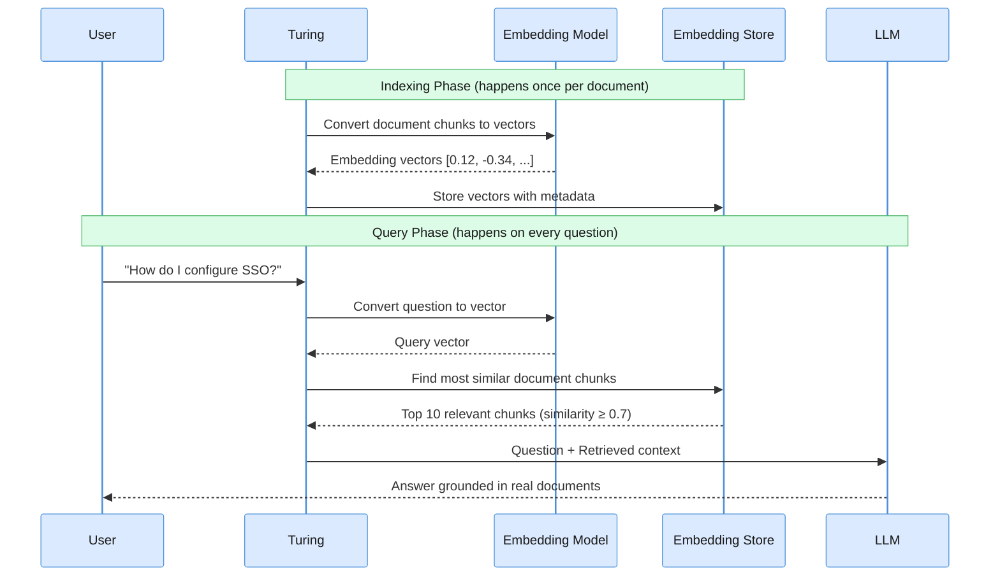
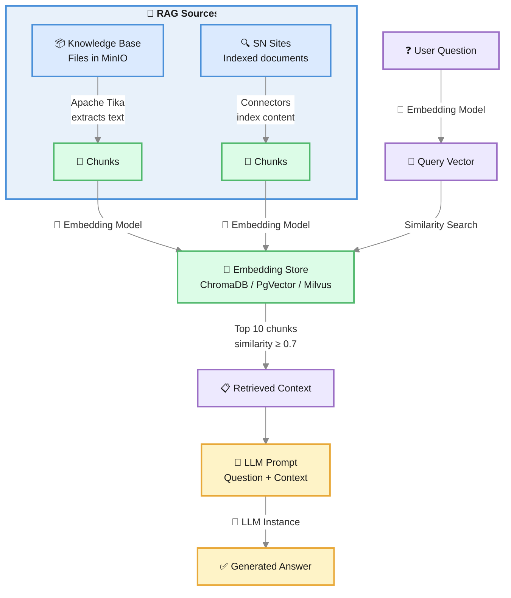

**RAG (Retrieval-Augmented Generation)** is the technique that makes AI responses accurate and grounded in your actual content instead of relying solely on the model's training data.

The core idea is simple: **before the LLM generates a response, the system retrieves the most relevant documents from your content and includes them in the prompt**. The LLM then answers based on real, up-to-date information rather than what it memorized during training.

---

## The Problem RAG Solves

Large Language Models are trained on vast amounts of text, but they have critical limitations:

- **Knowledge cutoff**: They don't know about content created after their training date
- **No access to private data**: They've never seen your internal documents, product specs, or company policies
- **Hallucination**: When they don't know an answer, they may generate plausible-sounding but incorrect information
- **Generic responses**: Without specific context, answers are broad and imprecise

RAG eliminates these problems by giving the LLM access to your actual content at query time.

---

## How RAG Works: Step by Step



### Phase 1: Indexing (one-time per document)

1. **Document ingestion**: Content enters Viglet Turing via connectors (AEM, web crawler) or file uploads (Assets/Knowledge Base)
2. **Text extraction**: Apache Tika extracts text from PDFs, DOCX, XLSX, HTML, and other formats
3. **Chunking**: The extracted text is split into chunks (default: 1,024 characters) to fit within embedding model limits
4. **Embedding**: Each chunk is passed through the **Embedding Model**, which converts text into a high-dimensional numerical vector (e.g., a 1,536-dimension array of floats)
5. **Storage**: The vectors are stored in the **Embedding Store** alongside metadata (source file, chunk position, original text)

### Phase 2: Retrieval (on every user question)

1. **Query embedding**: The user's question is converted into a vector using the **same Embedding Model**
2. **Similarity search**: The **Embedding Store** finds the vectors most similar to the query vector (cosine similarity)
3. **Threshold filtering**: Only chunks with similarity ≥ 0.7 are included (configurable)
4. **Top-K selection**: The top 10 most relevant chunks are selected
5. **Reranking (optional)**: A second, more precise relevance pass re-orders the candidates and keeps the best few before they reach the model (see [Reranking](#reranking-sharper-context-before-generation))

### Phase 3: Generation

1. **Prompt construction**: Turing builds a prompt containing the user's question plus the retrieved document chunks as context
2. **LLM generation**: The LLM reads the context and generates an answer based on the real content
3. **Streaming response**: The answer is streamed back to the user via SSE

---

## The Three Components

### LLM (Large Language Model)

The LLM is the "brain" that reads the retrieved context and generates a natural language response. It does the reasoning, summarization, and articulation, but it does **not** search or retrieve content on its own.

In Turing, LLMs are configured as **[LLM Instances](/docs/llm-instances/)** across **11 vendor types**:

| Provider | Example Models |
|---|---|
| **OpenAI** | GPT-4o, GPT-4o-mini |
| **Anthropic** | Claude Sonnet 4 |
| **Ollama** | Mistral, Llama, Qwen |
| **Google Gemini** | Gemini 2.0 Flash (native + OpenAI-compatible) |
| **AWS Bedrock** | Claude / Llama / Nova / Titan (IAM) |
| **Voyage / Cohere / Mistral / Vertex AI / OpenAI-Compatible** | see [LLM Instances](/docs/llm-instances/#supported-vendors) |

**The LLM does not store knowledge.** It only processes what's given to it in the prompt. RAG ensures the prompt contains the right content.

### Embedding Model

The Embedding Model is a specialized neural network that converts text into numerical vectors (arrays of floating-point numbers). These vectors capture the **semantic meaning** of the text: similar concepts end up with similar vectors, even if the words are different.

**Example:**

| Text | Vector (simplified) |
|---|---|
| "How to configure single sign-on" | `[0.82, -0.15, 0.44, ...]` |
| "SSO setup and authentication" | `[0.80, -0.13, 0.46, ...]` ← very similar! |
| "Weather forecast for tomorrow" | `[-0.31, 0.67, -0.22, ...]` ← very different |

The embedding model is used **twice**: once during indexing (to embed document chunks) and once at query time (to embed the user's question). Both must use the **same model**: otherwise the vectors are incompatible and similarity search fails.

In Turing, embedding-capable providers include **OpenAI**, **Ollama**, **Gemini** (with asymmetric task types), **Voyage**, **Cohere**, **Mistral**, **Bedrock**, **Vertex AI**, and OpenAI-compatible endpoints. See [Embedding Models](/docs/embedding-models/) for provider details, model selection, and advanced modes (multimodal, contextualized chunks, Matryoshka).

:::caution[Same model for indexing and querying]
Changing the embedding model after documents have been indexed causes dimension mismatches and incorrect results. A full re-indexing is required after any model change.
:::

### Embedding Store (Vector Database)

The Embedding Store is a specialized database optimized for storing and querying high-dimensional vectors. Unlike a traditional database that matches exact values, an embedding store finds the **most similar** vectors using distance metrics (cosine similarity, dot product, or Euclidean distance).

Turing supports four backends:

| Backend | Best for | How it works |
|---|---|---|
| **[ChromaDB](/docs/embedding-stores/#chromadb)** | Development, small/medium deployments | Lightweight, open-source, connects via HTTP API |
| **[PgVector](/docs/embedding-stores/#pgvector)** | Teams already using PostgreSQL | PostgreSQL extension: embeddings in the same DB as app data |
| **[Milvus](/docs/embedding-stores/#milvus)** | Large-scale production, high throughput | Purpose-built vector DB with advanced indexing (IVF, HNSW) |
| **[Lucene (embedded)](/docs/embedding-stores/#lucene-embedded)** | Single-node / zero-infra | Runs in-process, no external service; supports quantization |

**What happens inside the embedding store:**

```
Query vector: [0.82, -0.15, 0.44, ...]

Stored vectors:
  doc_chunk_42:  [0.80, -0.13, 0.46, ...]  → similarity: 0.97 ✅ (returned)
  doc_chunk_17:  [0.75, -0.20, 0.39, ...]  → similarity: 0.89 ✅ (returned)
  doc_chunk_91:  [-0.31, 0.67, -0.22, ...]  → similarity: 0.12 ❌ (below threshold)
```

---

## RAG in Turing

Turing supports two RAG sources that can be used independently or together:



### Knowledge Base (Assets)

Files uploaded to **[Assets](/docs/assets/)** are stored in the configured object/file store (MinIO, filesystem, or disabled), extracted with Apache Tika (supporting PDF, DOCX, XLSX, PPTX, HTML, TXT, and more), truncated to 100,000 characters, split into 1,024-character chunks, embedded, and stored in the active embedding store.

The Knowledge Base is queried by the `search_knowledge_base` tool: available in the Chat interface and configurable per AI Agent.

### Semantic Navigation Sites

When **GenAI** is enabled for an SN Site, indexed documents are also embedded alongside their Solr representation. This allows the SN Site chat and AI Agents to retrieve relevant content via semantic similarity.

Embedding never stands in the way of search. Each import batch is embedded once, fields left empty (a job posting with no salary) are simply left out of the chunk metadata, and if embedding a document fails, the failure is logged and the document is still indexed for search. Turning chat on for a site therefore cannot stop its connector's imports.

Configure this in **Semantic Navigation → [Site] → Generative AI**. See [Semantic Navigation](/docs/semantic-navigation/#generative-ai).

:::note[Re-indexing required]
Documents indexed before GenAI was enabled do not have embeddings. A full re-indexing of the site is required to make existing content available for RAG.
:::

---

## AI Agents + Semantic Navigation: The Full Loop

Here is the question that determines whether your AI feels alive: *when a user asks a question, does the agent answer from its training data, or does it search **your** content first?*

Turing gives the agent the tools to do both, and the wiring is what makes them work together as one experience.

### The two retrieval surfaces

An AI Agent that's wired for SN can reach the index through **two different routes**, each suited to a different shape of question.

| Route | Native tool | What it does | Best when |
|---|---|---|---|
| **Keyword + facets** | `search_site` (and the helpers `list_sites`, `get_site_fields`, `get_valid_filter_values`) | Sends a Solr query to the SN Site backend, with optional facet filters and locale. Returns documents with snippets and metadata. | The user asks for something *describable in your taxonomy*, a product category, a brand, a date range |
| **Semantic similarity (RAG)** | `search_knowledge_base` and the SN site's vector lookup | Embeds the user's question, retrieves the top-K most similar document chunks from the embedding store, and includes them in the prompt | The user asks something fuzzy: *"what does our policy say about X"*, *"is there a way to do Y"* |

Both call the *same indexed content*. The difference is **how** they search it. A site can have both enabled at once: the agent picks the right tool for the question.

### What happens at chat time

Here's the sequence when a user asks an SN-grounded agent: *"Which of our products are best for cold-storage logistics?"*

1. **Tool catalog presented to the LLM.** The agent has `search_site`, `find_similar_documents`, and `search_knowledge_base` attached. Their JSON schemas are part of the prompt; the model can pick any of them.
2. **LLM picks `search_site`.** It's a domain question with a clear filter (cold storage). The model emits a tool call: `search_site(site="products", query="cold storage logistics", locale="en_US")`.
3. **Solr handles the query.** Turing translates the tool arguments into a Solr query against the products SN Site, applies the configured facets, returns the top results with snippets.
4. **The model reads the snippets.** They're fed back as the tool's result. The model now has *real product names, real descriptions, real URLs*.
5. **Possibly a second tool call.** If the snippets are thin, the model may chain `find_similar_documents(documentId="<one-of-the-results>")` to broaden the recommendation. Or `search_knowledge_base("cold storage compliance")` to pull policy context.
6. **Final answer.** The model composes the response in the agent's voice (and its [Persona](/docs/personas/), if attached), with concrete product names and links, nothing hallucinated, everything grounded.

If the question had been different (say, *"Why does this product spec say it tolerates -25°C?"*) the LLM would have picked `search_knowledge_base` first, not `search_site`. The RAG embeddings carry semantics that keyword search doesn't.

### The Semantic Navigation chat tab

The [Chat](/docs/chat/) interface has a dedicated **Semantic Navigation** tab where these tools are pre-wired without you having to build an agent. Use it when you want raw, grounded search-with-explanation. The system prompt for that tab includes:

- The list of available SN Sites and their locales,
- The configured facets per site (so the model knows what filters it can apply),
- A directive to **never answer outside the indexed content**.

It's the Turing equivalent of *"talk to my site"*.

### Designing an SN-backed agent

A few patterns that work well:

- **Limit which sites an agent can search.** A sales agent shouldn't be searching the internal HR site. Even though `list_sites` returns all of them, you can shape behavior with the agent's system prompt: *"Only use the products and pricing SN Sites. Ignore others."*
- **Match agent persona to site content.** A persona that says *"speak like a brand voice"* paired with an HR knowledge base will sound off. Pair brand-voice personas with marketing/product sites; pair instructional personas with internal docs.
- **Combine SN search with Custom Tools for action.** Search returns information; a [Custom Tool](/docs/custom-tools/) (or MCP) takes action. *"Find me the right product"* → `search_site` → *"and book me a demo on it"* → custom tool that hits your CRM.

---

## The ANN Search Page: See Your Vectors

There's one question RAG operators always end up asking: *"Did the embedding store actually receive what I think it did?"*

The **ANN Search** page (`/ann/{siteName}`) is the answer. It's a developer-facing search page that hits the **vector store directly**: no LLM, no chat, no agent. You type a query, it embeds it, and shows you the raw top-K matches from the embedding store, with similarity scores and full metadata.

Think of it as the *"view source"* of your RAG pipeline.

### What it shows

| Column | Meaning |
|---|---|
| **Result content** | The actual chunk text the embedding store returned |
| **Score** | Similarity score (cosine, typically 0.0–1.0) |
| **Metadata** | The document's source: URL, file path, locale, custom fields you indexed |
| **Filters** | Faceted metadata so you can narrow the query (e.g., `locale = pt_BR`, `source = aem`) |
| **Pagination** | Browse beyond the immediate top-K when you want to see what's *just* below the threshold |
| **View raw JSON** | The full vector record as it lives in ChromaDB / PgVector / Milvus |

### When to open it

| Scenario | What ANN Search tells you |
|---|---|
| *"My agent isn't finding the policy doc I just uploaded."* | Search the page for the doc's title. If it's not there → indexing failed. If it's there with score 0.3 → embedding model is mismatched or chunks too coarse. |
| *"My RAG answers feel generic."* | Search a sample question. Look at the top 3 chunks. If they're all the same boilerplate, your chunking is too coarse. If they're irrelevant, the embedding model isn't right for your content. |
| *"I need to verify locale filtering works."* | Search with the locale facet. If the results aren't locale-scoped, the metadata isn't being indexed or the filter isn't being applied. |
| *"After a re-index, did everything come back?"* | Search a known document. If hit count drops vs. before, indexing dropped chunks. |
| *"I want to debug a single bad answer."* | Take the user's exact question, paste it into ANN Search, look at the top 10 chunks. Now you know exactly what context the LLM saw. |

### How it relates to the chat

ANN Search shares the same backing infrastructure as the agent's `search_knowledge_base` tool, same embedding model, same vector store, same query pipeline. **What you see in ANN Search is exactly what the LLM would have seen** when answering a related question.

This makes ANN Search the canonical debugging surface. Reproduce the chat answer there, and the cause is one of three things:

1. The chunks the LLM got are wrong → fix indexing or chunking,
2. The chunks were right but the LLM ignored them → tighten the agent system prompt or persona,
3. The chunks were right and the LLM used them but the user is asking something not covered → product gap, not a tech gap.

The first two you fix in Turing. The third is a roadmap signal.

:::note[ANN Search is RAG-only]
The ANN page only works on SN Sites where **GenAI is enabled** (i.e., embeddings are being indexed). If a site shows *"ANN Search is not available for this site (RAG is disabled)"*, the site doesn't have RAG turned on. Enable it in **Semantic Navigation → [Site] → Generative AI** and re-index.
:::

### REST API behind the page

The ANN page is just a UI over a small REST contract. Your own tools can call it directly:

```bash
POST /ann/{siteName}/search
Content-Type: application/json

{
  "query": "cold storage compliance",
  "locale": "en_US",
  "topK": 10,
  "filters": { "source": ["aem"] }
}
```

Response:

```json
{
  "query": "cold storage compliance",
  "locale": "en_US",
  "topK": 10,
  "page": 0,
  "pageSize": 10,
  "totalHits": 42,
  "hasMore": true,
  "results": [
    {
      "id": "doc-789-chunk-3",
      "content": "Storage at temperatures below -20°C requires...",
      "score": 0.92,
      "metadata": { "url": "...", "locale": "en_US", "source": "aem" }
    }
  ],
  "facets": {
    "source": [{ "value": "aem", "count": 38 }, { "value": "manual", "count": 4 }]
  }
}
```

This is also a useful endpoint for *automated quality checks*, a CI job that verifies critical content is still embedded after a re-index.

---

## Reranking: sharper context before generation

Similarity search is fast but coarse: a vector score is a good *first* guess at
relevance, not a final verdict. The top-K chunks it returns often include
near-duplicates, tangential matches, or passages that *mention* the query terms
without *answering* the question. Stuffing all of them into the prompt wastes
context and can dilute the answer.

**Reranking** adds a second, more discerning pass. After hybrid retrieval (BM25 +
vector) fuses and orders the candidates, an optional reranker re-scores the top
candidates against the question and keeps only the highest-precision few for the
prompt, fewer, better chunks instead of more, noisier ones.

```
Query ──► Hybrid retrieval (BM25 + vector, RRF) ──► top-N candidates
                                                        │
                                                        ▼
                                          Reranker re-orders by relevance
                                                        │
                                                        ▼
                                              keep top-K ──► LLM prompt
```

### Pluggable reranker strategies

Turing treats the reranking stage as a **selectable strategy**, so you can
match cost, latency, and precision to your deployment:

| Strategy | What it is | When to use |
|---|---|---|
| **LLM** *(default)* | Asks the configured chat model to rank the candidate snippets. No extra infrastructure. | Quick start; small candidate pools; you already pay for a chat model. |
| **Cross-encoder** | Calls a self-hosted `/rerank` endpoint running a purpose-built reranker model (e.g. `BAAI/bge-reranker-v2-m3`) via Text Embeddings Inference, Infinity, or a Jina-compatible server. | Best precision-per-cost. Local, free, fast (sub-100 ms). Recommended for production. |
| **Cohere** | Calls the managed [Cohere Rerank](https://docs.cohere.com/docs/rerank) API (`rerank-v3.5`). | Zero-ops; you'd rather not host a reranker. Requires a Cohere API key. |

**Safe by design: it never makes retrieval worse.** Reranking is *fail-open*: if
the chosen strategy errors, times out, isn't configured, or returns nothing
usable, Turing silently falls back to the original retrieval order. Turning
reranking on can only help or be neutral: it can never degrade results below the
no-rerank baseline.

### Enabling reranking

Reranking is configured under **Administration → Settings → Global Settings** in
the **RAG Reranker** section (off by default):

1. Toggle **Enable Reranker** on.
2. Pick a **Strategy** (`LLM`, `Cross-encoder`, or `Cohere`).
3. Set **Top-K kept**: how many of the highest-ranked chunks survive into the
   prompt (1–100, default 20).
4. For **Cross-encoder**, fill in the **Endpoint URL** (your `/rerank` server)
   and optionally a **Model** name.
5. For **Cohere**, paste your **API key** (stored encrypted) and optionally a
   **Model** name (defaults to `rerank-v3.5`).

See the [Configuration Reference](/docs/configuration-reference/#rag-reranker-database-settings)
for the exact setting keys and defaults. Managed reranker strategies (Cohere, Voyage,
Vertex AI Ranking, AWS Bedrock Rerank) and the full strategy reference live on the
dedicated **[Reranking](/docs/reranking/)** page.

---

## Advanced RAG capabilities

The default pipeline above (embed, retrieve, rerank, generate) is the foundation. Turing layers several **opt-in** capabilities on top of it, each fail-safe: when off (the default) or on error, the pipeline behaves exactly as the baseline.

### Managed-RAG retrieval backends

For tenants standardized on a cloud RAG stack, the *retrieval* half can be delegated to a managed service instead of the built-in vector/hybrid index, without rewriting the rest of the pipeline. A pluggable **retrieval backend** seam returns passages in the same shape as the built-in path, so retrieved documents still flow through reranking, the `sources[]` event, and native citations verbatim.

| Backend | What it is |
|---|---|
| **Built-in** *(default)* | Turing's own vector / hybrid index: unchanged |
| **AWS Bedrock Knowledge Bases** | Delegates retrieval to a Bedrock KB (`Retrieve` API); each result becomes a citation source through the existing citation path |

Configured as deploy-time infrastructure (`turing.retrieval.*`, like `turing.storage.*`); default `BUILT_IN` is byte-for-byte unchanged. Vertex AI Search / RAG Engine are future adapters on the same seam.

### Per-stage model "lanes"

RAG isn't one model call: it's many (query rewrite, router, rerank, judge, summarization, the final answer). **Model lanes** let you bind whole *classes* of work to different vendors: a cheap fast model for autocomplete/rewrite (`FAST`), a strong reasoner for rerank/judge (`REASONING`), and a low-cost model for background summarization (`CHEAP`). Each pipeline stage is mapped to a lane in code; you only configure three lane → instance bindings in Global Settings. A blank binding silently reverts that stage to the default LLM.

### Cost-aware cross-provider fallback

An OpenRouter-style layer that fails over to another vendor when a provider errors or rate-limits, and can route the **cheapest capable** instance first. The fallback chain is an ordered list of instances (each already wrapped in its own retry/circuit-breaker), routed by mode: `PRIORITY` (configured order) or `CHEAPEST` (ascending price). Streaming fails over only *before the first token* (so SSE text is never duplicated), and cost attributes to whichever vendor actually served. An empty chain = the legacy single-model path.

### Answer-grounding guardrail

Validates at answer time that the streamed answer is actually grounded in the retrieved context (and screens it for unsafe content / PII) the managed complement to citation-drift detection. A pluggable guardrail strategy (`NONE` / **AWS Bedrock Guardrails** / **OpenAI Moderation** / **Mistral Moderation**) re-reads the assembled answer against the retrieved chunk texts (teed server-side, never exposed on `sources[]`) and emits a `grounding` SSE event with a confidence verdict; in block-on-violation mode it replaces the answer with redacted/blocked text. Both SDKs surface it (`onGrounding`); the admin chat renders a confidence badge. Opt-in via `turing.safety.guardrail.*`, fail-open, a guardrail outage never blocks an answer.

### Multi-provider "second opinion"

For high-stakes answers, a cheap model from a **different vendor** critiques the primary RAG answer (a cross-vendor fact-check judge) and the agreement is surfaced beside it as a confidence signal: it never alters the answer. The cross-vendor constraint is enforced (a same-family second view shares blind spots). Emitted as a `secondOpinion` SSE event; the admin renders an agrees/disagrees badge. Opt-in via Global Settings; fail-open.

---

## Provenance & citations

RAG grounds an answer in real content; **citations** prove *which* content grounded *which sentence*. When the `citations` Request Option is enabled on a supporting vendor, Turing retrieves the top-K passages, attaches them to the question as citable source blocks, and decodes the model's per-sentence citations onto one provider-agnostic contract, streamed as a `citations` SSE event after the answer.

| Vendor | How citations are produced |
|---|---|
| **Anthropic** | Native `search_result` / `document` content blocks with `citations: enabled`, per-sentence char/page spans |
| **Gemini** | Google Search grounding metadata (per-segment support + source spans) |
| **Cohere** | Native citation mode (`POST /v2/chat` `documents` array) decoded onto the same contract |
| **Bedrock KB** | Each Knowledge-Base result becomes a citation source through the same path |

The chat UI underlines the exact span each claim is grounded on, with a hover popover showing the source quote and a deep link.

### Citation drift detection

Provenance becomes *auditable over time*. When citation drift is enabled (`turing.genai.citation-drift.enabled=true`), every per-sentence citation is persisted (source id, cited span, the question, the answer instant). A daily job re-resolves recent records against the live index and flips a record **stale** when the source was re-indexed since the answer or the cited span is no longer present, answering the compliance question *"what document did this answer cite, and has it changed since?"* Query it at `GET /api/chat/sessions/{conversationId}/citation-drift` (`?recheck=true` for an on-demand pass). Strictly opt-in: default off writes no rows and the streaming path is unchanged.

---

## Practical Example

Imagine a company with an internal knowledge base containing HR policies, product documentation, and engineering guides.

**Without RAG:**

> **User:** "What is our vacation policy for remote employees?"
>
> **LLM:** "Typically, companies offer 15-20 days of PTO..." *(generic, possibly wrong for this company)*

**With RAG:**

> **User:** "What is our vacation policy for remote employees?"
>
> **Turing retrieves:** Chunk from `hr-policies-2025.pdf` (page 12): *"Remote employees are entitled to 25 days of paid leave per year, plus 5 floating holidays. Requests must be submitted via the HR portal at least 14 days in advance..."*
>
> **LLM (with context):** "According to our HR policies, remote employees receive 25 days of paid leave per year plus 5 floating holidays. Leave requests must be submitted via the HR portal at least 14 days in advance." *(accurate, sourced from actual company data)*

---

## Key Configuration

| Setting | Where | Default | Impact |
|---|---|---|---|
| **Embedding Store** | Administration → Settings | n/a | Which vector database to use |
| **Embedding Model** | Administration → Settings | Provider default | Quality and dimensions of vectors |
| **Default LLM Instance** | Administration → Settings | n/a | Which model generates responses |
| **RAG Enabled** | Administration → Settings | Off | Whether new SN Sites have RAG by default |
| **Top-K results** | Internal | 10 | How many chunks are retrieved |
| **Similarity threshold** | Internal | 0.7 | Minimum similarity to include a chunk |
| **Enable Reranker** | Administration → Settings | Off | Run an optional reranking pass before generation |
| **Reranker Strategy** | Administration → Settings | LLM | `LLM`, `Cross-encoder`, or `Cohere` |
| **Reranker Top-K kept** | Administration → Settings | 20 | Chunks kept after reranking narrows the pool |

---

## Related Pages

| Page | Description |
|---|---|
| [Generative AI & LLM Configuration](/docs/genai-llm/) | Global GenAI settings and architecture overview |
| [LLM Instances](/docs/llm-instances/) | Configure LLM providers (11 vendors) |
| [Reranking](/docs/reranking/) | Pluggable + managed rerankers (Cohere / Voyage / Vertex / Bedrock) |
| [Capabilities](/docs/capabilities/) | The `citations` Request Option and the two-level gate |
| [Embedding Stores](/docs/embedding-stores/) | Vector backends (ChromaDB, PgVector, Milvus, embedded Lucene) |
| [Embedding Models](/docs/embedding-models/) | Provider support, advanced embedding modes |
| [Assets](/docs/assets/) | Knowledge Base file management |
| [AI Agents](/docs/ai-agents/) | Compose agents with RAG tools |
| [Tool Calling](/docs/tool-calling/) | RAG / Knowledge Base tools reference |

---


