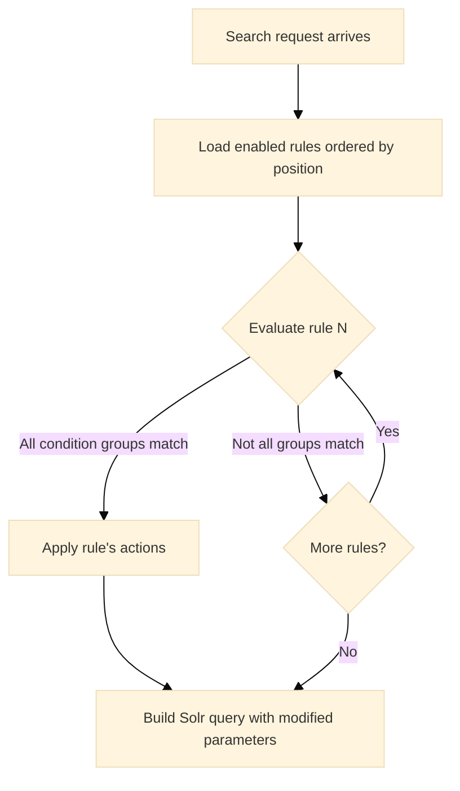

This page is for administrators who want an SN site to adjust a search by itself. You
manage rules in the site's **Search Rules** tab.

Search rules change a Semantic Navigation search from conditions evaluated at query time. When a rule's conditions match the incoming search request, its actions are applied to the Solr query (overriding sort, adding filters, changing facets, or boosting results) all without any client-side logic.

Rules use **first-match semantics**: they are evaluated in position order, and only the first matching rule's actions are applied.

## Rule structure

Each rule has three parts:

| Part | Description |
|---|---|
| **Details** | Name, description, position (priority), and enabled/disabled toggle |
| **Conditions** | One or more conditions grouped by parameter: all groups must match (AND between groups) |
| **Actions** | One or more actions applied when the rule matches |

## Conditions

Conditions define **when** a rule triggers. Each condition evaluates a search parameter against a value using an operator.

### Parameters

| Parameter | Description | Example |
|---|---|---|
| `QUERY` | The user's search query (`q` parameter) | User searched for "education" |
| `FILTER_QUERY` | Active facet filters (`fq` parameter) | User filtered by `category:books` |
| `SORT` | Current sort specification | Sort is "newest" |
| `LOCALE` | Current locale | Locale is `pt_BR` |

### Operators

| Operator | Description |
|---|---|
| `EQUALS` | Exact match |
| `CONTAINS` | Value contains the substring |
| `STARTS_WITH` | Value starts with the substring |
| `MATCHES_ANY` | Value contains the substring (alias for CONTAINS) |
| `IS_EMPTY` | Parameter has no value |

### Condition grouping

Conditions are grouped by parameter. Within a group, conditions are combined using the **logic operator** (`AND` or `OR`). Between different parameter groups, `AND` is always used.

```text
Example: "When query contains 'laptop' OR 'notebook', AND locale is pt_BR"

Condition Group 1 (QUERY, OR):
  - QUERY CONTAINS "laptop"
  - QUERY CONTAINS "notebook"

Condition Group 2 (LOCALE):
  - LOCALE EQUALS "pt_BR"

Evaluation: (Group 1 OR) AND (Group 2) → both groups must match
```

:::note
`SORT` and `LOCALE` parameters always use OR logic internally, regardless of the configured logic operator.
:::

## Actions

Actions define **what happens** when the rule matches. Multiple actions can be applied by a single rule.

| Action | Description | Value format |
|---|---|---|
| `SET_SORT` | Override the sort order | Sort name (e.g., `newest`, custom sort name, or `field:direction`) |
| `SET_ROWS` | Change the number of results per page | Integer (e.g., `20`) |
| `ADD_FACETS` | Add facets to the response | Comma-separated field names (e.g., `brand,color`) |
| `REMOVE_FACETS` | Hide facets from the response | Comma-separated facet names |
| `ADD_FILTER_QUERY` | Automatically apply a filter | Filter expression (e.g., `type:article`) |
| `SET_BOOST_QUERY` | Boost specific documents | Boost expression (e.g., `featured:true^10`) |

:::tip[SET_SORT and SET_ROWS are single-use]
Each rule can have at most one `SET_SORT` and one `SET_ROWS` action. The UI prevents adding duplicates.
:::

## How rules are evaluated



Rules are evaluated **before** the Solr query is built, allowing them to modify sort, facets, filters, and boost queries before they are sent to the search engine.

## Examples

### Example 1: Force sort for product queries

When the user searches for "cheap" or "affordable", sort by price ascending:

| Part | Configuration |
|---|---|
| **Condition** | QUERY CONTAINS "cheap" OR QUERY CONTAINS "affordable" |
| **Action** | SET_SORT → `price_asc` (a custom sort) |

### Example 2: Add filters for a specific locale

When the locale is `pt_BR`, automatically filter to Portuguese content:

| Part | Configuration |
|---|---|
| **Condition** | LOCALE EQUALS "pt_BR" |
| **Action** | ADD_FILTER_QUERY → `language:pt` |

### Example 3: Boost featured content and limit results

When the query is empty (wildcard search), boost featured content and show fewer results:

| Part | Configuration |
|---|---|
| **Condition** | QUERY IS_EMPTY |
| **Actions** | SET_BOOST_QUERY → `featured:true^10`, SET_ROWS → `5` |

### Example 4: Show specific facets for filtered searches

When the user filters by `category:electronics`, add brand and price facets:

| Part | Configuration |
|---|---|
| **Condition** | FILTER_QUERY EQUALS `category:electronics` |
| **Action** | ADD_FACETS → `brand,price_range` |

## Endpoints

| Method | Endpoint | Description |
|---|---|---|
| `GET` | `/api/sn/{siteId}/search-rule` | List all rules (ordered by position) |
| `GET` | `/api/sn/{siteId}/search-rule/{id}` | Get a rule with conditions and actions |
| `GET` | `/api/sn/{siteId}/search-rule/fields` | List available fields for conditions |
| `POST` | `/api/sn/{siteId}/search-rule` | Create a new rule |
| `PUT` | `/api/sn/{siteId}/search-rule/{id}` | Update a rule |
| `DELETE` | `/api/sn/{siteId}/search-rule/{id}` | Delete a rule |

## Related pages

| Page | What it covers |
|---|---|
| [Semantic Navigation](/docs/semantic-navigation/#custom-sort) | Custom sorts a `SET_SORT` action can name |
| [Targeting rules](/docs/targeting-rules/) | Filters the client sends for each user |
| [REST API](/docs/rest-api/) | The search request the conditions read |
