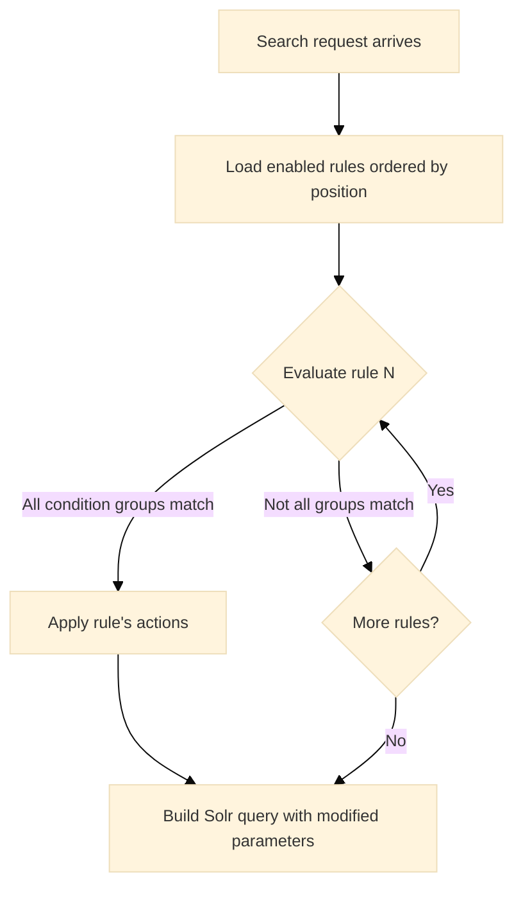

The **Semantic Navigation** page (`/admin/sn`) manages the search experiences that power every user-facing search in Viglet Turing. It is accessible from the **Enterprise Search** section of the sidebar.

Each **Semantic Navigation Site** (SN Site) is a complete, independently configured search experience: it defines which content is indexed, which search engine backend is used, how results are presented, which AI features are enabled, and how the front-end should render the response. A single Turing instance can host multiple SN Sites.

For a conceptual overview of what SN Sites are and how they relate to the rest of the system, see [Core Concepts](/docs/getting-started/core-concepts/).

---

## Site Listing

The page displays all configured SN Sites as a grid of cards (title and description). Use the **"New"** button to create a new site. When no sites exist, a blank state guides you to create the first one.

---

## Site Configuration

Clicking a site opens its configuration, organized into tabs. Each tab covers a distinct aspect of the site's behaviour.

---

### Settings

General identity and search engine binding for the site.

| Attribute | Description |
|---|---|
| **Name** | Identifier for the site: used in API URLs (e.g., `/api/sn/{Name}/search`) |
| **Description** | Human-readable description shown in the console |
| **Search Engine** | The Search Engine instance that stores and searches content for this site. See [Search Engine](/docs/search-engine/) |
| **Thesaurus** | Enables thesaurus-based query expansion: matching synonyms and related terms |
| **Search Template** | SPA Page used as the search interface for this site. See [Search Template](#search-template) below |

#### Search Template

The **Search Template** setting allows you to assign a deployed [SPA Page](/docs/spa-pages/) as the custom search interface for an SN site. When configured, visiting the site's search URL serves the selected SPA instead of the default built-in search page.

| Search URL | Behavior |
|---|---|
| `GET /sn/{siteName}` | Serves the SPA Page selected in Search Template |
| `GET /sn/{siteName}/any/path` | Serves the SPA with client-side routing fallback to `index.html` |

**How it works:**

1. Deploy a SPA via **Enterprise Search > [Pages](/docs/spa-pages/)** (upload a ZIP with your built React/Vue/Angular app)
2. Open the SN site's **Settings** tab
3. Select the deployed page from the **Search Template** dropdown
4. The site's search URL (`/sn/{siteName}`) now serves your custom SPA

When no template is selected (or storage is disabled), the site uses the default built-in search interface.

:::tip[Build with the React SDK]
Use the [Turing React SDK](/docs/react-sdk/) (`@viglet/turing-react-sdk`) to build custom search SPAs with hooks for search, facets, pagination, and autocomplete. Deploy the built app via Pages and assign it as the Search Template, the SPA communicates with the Turing REST API on the same origin, so no CORS configuration is needed.
:::

:::note[Storage required]
The Search Template dropdown only appears when a [storage backend](/docs/configuration-reference/#storage) is configured. If no SPA Pages have been deployed yet, the dropdown shows a message indicating no pages are available.
:::

---

### Multi Languages

Defines which locales are active for this site and maps each locale to a search engine core (collection).

| Attribute | Description |
|---|---|
| **Language** | Locale code for this language variant (e.g., `en_US`, `pt_BR`) |
| **Core** | The Solr core (or Elasticsearch index) where content for this locale is stored and searched |

Each locale is indexed and searched independently. The `Accept-Language` request header or the `_setlocale` query parameter selects the active locale at search time.

**Open Search button:** Next to each locale row, the **Open Search** button opens the HTML search page for that locale at:

```
GET http://localhost:2700/sn/<SITE_NAME>
```

---

### Behavior

Controls how the search engine processes queries and assembles results for this site. All settings are managed via `GET / PUT /api/sn/{id}`.

#### General

| Setting | Description |
|---|---|
| **Rows per Page** | Number of results returned per search request |
| **Exact Match** | When enabled, terms wrapped in quotes trigger an exact phrase match instead of a tokenized search |

#### Wildcard

| Setting | Description |
|---|---|
| **Wildcard No Results** | Automatically appends a wildcard (`*`) to the query when the original search returns no results, broadening the match |
| **Wildcard Always** | Always appends a wildcard to every search term, regardless of result count |
| **Retry with the main words on no results** | When a search finds nothing with every word required (after the wildcard retry), searches again without the language's stop words, matching at least half of the remaining words. Off by default |

Use **Wildcard No Results** to recover gracefully from zero-result queries.

Every word of a query is required, so a question typed into the search box ("What do I
need for two days in the hills?") finds nothing: "what", "do" and "for" must match too.
Turn on **Retry with the main words on no results** and that question is searched again
as `need two days hills`, any half of them matching. The response says so in
`queryContext.relaxed: true`, so a client can show "showing results for the main
words"; `queryContext.query.queryString` stays what the visitor typed. A one-word query,
a phrase in quotes and a query using `field:value` or a wildcard are never relaxed. The
stop words are the search locale's language (English, Portuguese, Spanish, French,
German, Italian and the other Snowball languages); a language without a list keeps
every word.

:::caution[Wildcard Always reduces precision]
**Wildcard Always** appends `*` to every query term regardless of result count. This increases recall (more documents match) but significantly reduces relevance precision. Avoid using it in sites where ranking quality matters. Prefer **Wildcard No Results** as a safer fallback.
:::

#### Facets

| Setting | Description |
|---|---|
| **Facet** | Enables or disables faceted navigation for this site |
| **Items per Facet** | Maximum number of values displayed per facet in the result panel |
| **Facet Sort** | How facet values are ordered: by document count (`COUNT`) or alphabetically (`ALPHABETICAL`) |
| **Facet Type** | How **different facets** combine with each other: `AND` or `OR`. Default: `AND` |
| **Facet Item Type** | How **values within the same facet** combine with each other: `AND` or `OR`. Default: `AND` |

##### Understanding Facet Type vs Facet Item Type

These two settings control **different levels** of the filter query. Think of a search where the user has selected filters from two facets:

- **Category** facet: selected `News` and `Blog`
- **Year** facet: selected `2024`

**Facet Item Type** controls how `News` and `Blog` combine (they're items **within the same facet**):

| Facet Item Type | Filter logic | Practical effect |
|---|---|---|
| **OR** (recommended) | `category:"News" OR category:"Blog"` | Show documents that are News **or** Blog: **broadens** results within this facet |
| **AND** | `category:"News" AND category:"Blog"` | Show documents that are News **and** Blog simultaneously, **narrows** results (often returns 0 results for single-value fields) |

**Facet Type** controls how the Category group and the Year group combine (they're **different facets**):

| Facet Type | Filter logic | Practical effect |
|---|---|---|
| **AND** (recommended) | `(category filter) AND (year filter)` | Results must match **both** facets: **narrows** results progressively as more facets are selected |
| **OR** | `(category filter) OR (year filter)` | Results can match **either** facet: **broadens** results when more facets are selected |

##### The four combinations

```
User selects: Category = [News, Blog] + Year = [2024]

┌──────────────────────────────────────────────────────────────────────┐
│ Facet Type = AND, Facet Item Type = OR  (recommended default)       │
│                                                                      │
│ Solr fq: (category:"News" OR category:"Blog") AND (year:2024)       │
│                                                                      │
│ "Show me News or Blog articles, but only from 2024"                  │
│ → Progressive filtering: each new facet narrows results              │
│ → Multiple values in same facet broaden within that dimension        │
└──────────────────────────────────────────────────────────────────────┘

┌──────────────────────────────────────────────────────────────────────┐
│ Facet Type = AND, Facet Item Type = AND                              │
│                                                                      │
│ Solr fq: (category:"News" AND category:"Blog") AND (year:2024)      │
│                                                                      │
│ "Show me documents tagged both News AND Blog, from 2024"             │
│ → Only useful for multi-valued fields (tags, categories)             │
│ → Single-value fields return 0 results with multiple selections      │
└──────────────────────────────────────────────────────────────────────┘

┌──────────────────────────────────────────────────────────────────────┐
│ Facet Type = OR, Facet Item Type = OR                                │
│                                                                      │
│ Solr fq: (category:"News" OR category:"Blog") OR (year:2024)        │
│                                                                      │
│ "Show me anything that is News, Blog, OR from 2024"                  │
│ → Very broad: adding more facets increases results                   │
│ → Useful for discovery/exploration interfaces                        │
└──────────────────────────────────────────────────────────────────────┘

┌──────────────────────────────────────────────────────────────────────┐
│ Facet Type = OR, Facet Item Type = AND                               │
│                                                                      │
│ Solr fq: (category:"News" AND category:"Blog") OR (year:2024)       │
│                                                                      │
│ "Show me documents tagged both News AND Blog, OR anything from 2024" │
│ → Uncommon combination                                               │
└──────────────────────────────────────────────────────────────────────┘
```

:::tip[Recommended configuration]
For most search interfaces, use **Facet Type = AND** with **Facet Item Type = OR**. This gives users the intuitive behavior of narrowing results as they add facets, while allowing multiple selections within a single facet to broaden within that dimension. This is the standard pattern used by e-commerce sites and enterprise search portals.
:::

##### Override priority

The facet operators are resolved with a three-level priority:

1. **Request-level** (highest): the `fqOperator` and `fqItemOperator` fields in the POST body override everything
2. **Field-level**: each field can set its own `Facet Type` and `Facet Item Type` in the Fields configuration (set to `DEFAULT` to inherit from site)
3. **Site-level** (fallback): the values configured here in the Behavior tab

This allows fine-grained control: for example, the site default can be `Facet Type = AND`, while a `tags` field overrides its `Facet Item Type` to `OR` because tags are multi-valued and should always use OR logic.

##### Secondary Facets

Any field configured as a facet can additionally be promoted to a **Secondary Facet** in the field's settings. Secondary facets are returned in a separate `widget.secondaryFacet` section of the search response, completely independent from the regular `widget.facet` section. This gives the front-end full control over how to render them, for example, a `content_type` field configured as a secondary facet can be rendered as navigation tabs ("All · Articles · Videos · Downloads") while the remaining facets appear as sidebar filters. The field must be a facet first; secondary facet is a promotion, not a replacement.

#### Highlighting

| Setting | Description |
|---|---|
| **HL** | Enables term highlighting in search result snippets |
| **HL Pre** | Opening HTML tag wrapping matched terms (e.g., `<mark>` or `<b>`) |
| **HL Post** | Closing HTML tag (e.g., `</mark>` or `</b>`) |

The HL Pre and HL Post values are injected directly around matched terms in the `text` and `description` fields of each result. Your front-end application receives the pre-highlighted HTML and renders it as-is.

#### Spell Check

| Setting | Description |
|---|---|
| **Spell Check** | Enables spelling suggestion when the query term is not found or returns few results |
| **Spell Check Fixes** | When enabled, automatically re-runs the search using the corrected term and returns those results instead of showing a "Did you mean?" prompt |

#### More Like This (MLT)

| Setting | Description |
|---|---|
| **MLT** | Enables the More Like This feature, which finds documents semantically similar to a given result |

When MLT is enabled, each search result can be expanded to show related documents: useful for discovery experiences and content recommendation.

#### Spotlight

| Setting | Description |
|---|---|
| **Spotlight with Results** | When enabled, curated Spotlight documents are displayed alongside organic results. When disabled, Spotlights are shown only when the query matches a spotlight term and no organic results are returned |

#### Default Field Mappings

These settings map the SN Site's canonical display fields to the actual field names in the Solr index. They allow the front-end application to always reference a consistent set of fields regardless of how connectors named the fields at indexing time.

| Setting | Description |
|---|---|
| **Title** | Field used as the result title |
| **Text** | Field used as the main body / snippet text |
| **Description** | Field used as the result description |
| **Date** | Field used as the result date |
| **Image** | Field used as the result thumbnail image URL |
| **URL** | Field used as the result link |
| **Default Field** | The field Solr uses for full-text search when no specific field is targeted in the query |
| **Exact Match Field** | The field used when the user searches with quoted terms (exact match mode) |

---

### Fields

Lists all fields configured for this site. Each field defines how a document attribute is indexed, searched, and presented.

#### Field Listing

| Column | Description |
|---|---|
| **Field** | Field name as it appears in the Solr schema |
| **Enabled** | Whether this field is active |
| **MLT** | Whether this field is included in More Like This queries |
| **Facets** | Whether this field is exposed as a facet filter |
| **Secondary Facet** | Whether this facet is promoted to the `secondaryFacet` section of the search response |
| **Highlighting** | Whether highlighted snippets are returned for this field |

#### Field Detail

Clicking a field opens its detail form:

| Attribute | Description |
|---|---|
| **Name** | Field identifier: must match the Solr schema field name |
| **Description** | Purpose or contents of this field |
| **Type** | Data type: `INT`, `LONG`, `FLOAT`, `DOUBLE`, `CURRENCY`, `STRING`, `DATE`, or `BOOL` |
| **Multi Valued** | Whether the field holds an array of values |
| **Facet Name** | Display label shown in the search UI facet panel |
| **Facet** | Whether to expose this field as a filter facet |
| **Secondary Facet** | Promotes this facet to the `secondaryFacet` section of the search response (e.g., for rendering as navigation tabs) |
| **Highlighting** | Whether to return highlighted snippets for this field |
| **MLT** | Whether this field participates in More Like This queries |
| **Enabled** | Whether this field is active |
| **Required** | Whether the field must be present when indexing a document |
| **Default Value** | Value used when a document is indexed without this field |
| **Search weight** | How much a query match in this field counts, from 1 to 100 (empty means 1). Set `title` to 3 so a title match outranks the same word in the body. Works on Solr and the embedded Lucene engine |

On the embedded Lucene engine, a title that holds a query of two words or more as an
exact phrase is boosted on top of the search weight: the site's default title field is
searched for the query as typed, without synonyms. A guide titled "How to choose a
waterproof jacket" then ranks above products that match only a synonym such as "rain
jacket". Solr and Elasticsearch do not apply this boost yet.

:::tip[Secondary Facets]
A secondary facet is a regular facet that is additionally returned in a separate `secondaryFacet` section of the search response. This lets the front-end render it differently, for example, as horizontal tabs ("All · Articles · Videos"), while other facets appear as sidebar filters. The field must have **Facet** enabled first; **Secondary Facet** is a promotion, not a replacement.
:::

#### Field-Level Facet Overrides

Beyond the standard settings, each field can override the site-level facet behavior:

| Field setting | Description |
|---|---|
| **Facet Type** | Overrides the site-level operator between this facet and others (`AND` / `OR`) |
| **Facet Item Type** | Overrides the site-level operator between values within this facet (`AND` / `OR`) |
| **Facet Range** | Enables date range faceting for this field. Instead of listing discrete values, the facet groups documents by predefined date periods: **day**, **month**, or **year** |

A date field configured with **Facet Range** groups results into date period buckets rather than listing individual values. The available granularities are **day**, **month**, and **year**, selected in the field configuration. The response returns one facet item per period that has at least one matching document, each with its pre-built filter link.

#### Custom Facets

**Custom Facets** let you define the exact items that appear in a facet, each with its own filter rule, label, and position: rather than relying on the values that happen to exist in the index. They are created from an existing field and appear automatically in the search response alongside regular facets, following the site's behavior settings.

This is useful when the raw field values are not user-friendly, when you want to group multiple values into a named bucket, or when you need range-based navigation (e.g., price ranges, date periods, score thresholds).

**Custom Facet item operators**

Each item in a Custom Facet is defined by an operator that generates its Solr filter query:

| Operator | Behavior | Example |
|---|---|---|
| **EQUAL** | Matches documents where the field equals the specified value exactly | `content_type = "video"` |
| **BETWEEN** | Matches documents where the field value falls within a range (inclusive) | `price between 100 and 500` |
| **GREATER_THAN** | Matches documents where the field value is above the threshold | `score > 80` |
| **LESS_THAN** | Matches documents where the field value is below the threshold | `date < 2020-01-01` |

**Custom Facet item configuration**

| Setting | Type | Description |
|---|---|---|
| **label** | `string` | The display name shown in the facet panel (e.g., "Last 30 days", "Under $100") |
| **operator** | `enum` | The filter operator: `EQUAL`, `BETWEEN`, `GREATER_THAN`, or `LESS_THAN` |
| **rangeStart** | `BigDecimal` | Start of a numeric range (used with `BETWEEN` and `GREATER_THAN`) |
| **rangeEnd** | `BigDecimal` | End of a numeric range (used with `BETWEEN` and `LESS_THAN`) |
| **rangeStartDate** | `Instant` | Start of a date range (used with `BETWEEN` and `GREATER_THAN` for date fields) |
| **rangeEndDate** | `Instant` | End of a date range (used with `BETWEEN` and `LESS_THAN` for date fields) |
| **position** | `integer` | The order in which this item appears within the facet |

**How it works**

Once a Custom Facet is saved, Turing generates the facet items automatically on every search request. Each item appears in the `widget.facet` (or `widget.secondaryFacet`) section of the response with its pre-built filter link, exactly like a regular facet value. The front-end renders it without any special handling: Custom Facets are indistinguishable from regular facets in the response structure.

**Example: Price range facet**

A field `price` (numeric type) configured as a Custom Facet with four items:

| Label | Operator | rangeStart | rangeEnd |
|---|---|---|---|
| Under $50 | `LESS_THAN` | n/a | 50 |
| $50 – $200 | `BETWEEN` | 50 | 200 |
| $200 – $500 | `BETWEEN` | 200 | 500 |
| Over $500 | `GREATER_THAN` | 500 | n/a |

The search response returns these four items as a facet, each with a pre-built filter link, exactly like regular facet values.

**Example: Score threshold facet**

A field `relevance_score` configured as a Custom Facet:

| Label | Operator | rangeStart | rangeEnd |
|---|---|---|---|
| High relevance | `GREATER_THAN` | 80 | n/a |
| Medium relevance | `BETWEEN` | 50 | 80 |
| Low relevance | `LESS_THAN` | n/a | 50 |

**Example: Date range facet**

For date fields, use `rangeStartDate` and `rangeEndDate` (Instant values) instead of the numeric fields:

| Label | Operator | rangeStartDate | rangeEndDate |
|---|---|---|---|
| This year | `GREATER_THAN` | `2026-01-01T00:00:00Z` | n/a |
| Last year | `BETWEEN` | `2025-01-01T00:00:00Z` | `2025-12-31T23:59:59Z` |
| Older | `LESS_THAN` | n/a | `2025-01-01T00:00:00Z` |

:::note[Custom Facets use explicit values, not Solr expressions]
Custom Facet items use concrete `BigDecimal` values (for numeric fields) or `Instant` timestamps (for date fields). Solr query expressions like `NOW-7DAYS` are not supported: use absolute values instead.
:::

---

### Merge Providers

Merge Providers enable Turing to detect when two connectors have indexed the same real-world document and merge their fields into a single enriched Solr document.

#### What they are

Merge Providers solve the problem of having two independent connectors that index different representations of the same real-world document. Without merging, the same content ends up as two separate entries in the search index (one from each connector) with incomplete information in each.

A classic example: an **AEM connector** indexes structured data from the CMS (`model.json`), capturing content metadata such as content type, author, tags, and structured fields. A **WebCrawler** indexes the same page as rendered HTML, capturing the full readable text. Both connectors run independently and neither has access to the data the other collects.

Merge Providers instruct Turing to detect when both connectors have indexed the same document and merge their content into a single, enriched Solr document.

#### How they work

A Merge Provider is configured with:

1. **A join key**: a pair of fields, one from each connector, whose values identify the same document. For example, the `url` field in the AEM document equals the `id` field in the WebCrawler document.

2. **A set of field overwrite rules**: which fields from the source connector (the one arriving second) should overwrite fields in the destination document (the one already in the index).

When the indexing pipeline receives a document from connector B and finds that a document from connector A already exists in the index with a matching join key value, it fetches the existing document, applies the field overwrite rules, and writes the merged result back to Solr.

```
AEM Connector indexes:
  id:        "aem-12345"
  url:       "https://example.com/products/widget"
  title:     "Widget Pro"
  author:    "Marketing"
  tags:      ["product", "hardware"]
  text:      ""   ← empty, AEM doesn't have full text

WebCrawler indexes:
  id:        "https://example.com/products/widget"
  text:      "The Widget Pro is a high-performance..."   ← full page text
  title:     "Widget Pro - Example"

Merge Provider configuration:
  Join key:        AEM.url  =  WebCrawler.id
  Overwrite field: text  ← WebCrawler.text → AEM document

Result in Solr:
  id:        "aem-12345"
  url:       "https://example.com/products/widget"
  title:     "Widget Pro"
  author:    "Marketing"
  tags:      ["product", "hardware"]
  text:      "The Widget Pro is a high-performance..."   ← from WebCrawler
```

The final document in the index has the structured metadata from AEM and the full text from the WebCrawler, enabling both faceted navigation (using AEM's tags and metadata) and full-text search (using the crawled content).

#### Configuration

Each Merge Provider entry defines:

| Field | Description |
|---|---|
| **providerFrom** | The source connector whose incoming document provides field values |
| **providerTo** | The destination connector whose existing document in the index will be updated |
| **relationFrom** | The field in the source document used as the join key |
| **relationTo** | The field in the destination document used as the join key |
| **locale** | The locale this merge provider applies to |
| **description** | Optional description of the merge provider's purpose |

Each entry has a set of **overwrittenFields**, the field names from the source that replace values in the destination document.

#### Important considerations

:::caution[Connector indexing order matters]
The merge is triggered when the **source** connector's document arrives and a matching **destination** document already exists in the index. If the destination connector runs after the source, no merge will occur until the source re-indexes. Always schedule the **destination connector first** so the document is already in Solr when the source arrives.
:::

**Join key uniqueness:** The field used as the join key must uniquely identify a document within its connector's output. If multiple documents share the same join key value, the merge behavior is undefined.

**Field type compatibility:** The fields being merged must have compatible types in the Solr schema. Merging a multi-value field into a single-value field, or a date into a string, will cause indexing errors.

**Merge scope:** Merge Providers are site-scoped. The same connector can participate in different merge configurations across different SN Sites.

---

### Targeting Rules

Targeting Rules are a search-time personalization mechanism that filters results based on user profile attributes: group, role, segment, country, department, or any indexed field. They allow different users to see different content from the same Solr index without maintaining separate cores or running multiple queries.

**There is no admin UI for Targeting Rules.** Rules are passed by the client in the body of the `POST /api/sn/{siteName}/search` request and applied dynamically at query time. The Solr schema only needs to have the targeting attributes indexed on the documents.

Common use cases:

- Corporate portal: show HR documents only to employees in the HR department
- E-commerce: show promotions for the user's country and loyalty segment
- Intranet: restrict confidential documents to users with the correct access group
- SaaS platform: filter documentation by the user's subscription tier

#### How the pipeline works


#### Four rule types

Targeting Rules are sent in the POST request body (see [POST Body Parameters](/docs/rest-api/#post-body-parameters)). The four types differ in how values are combined across attributes:

##### 1. `targetingRules`: simple list

A flat array of `attribute:value` strings. Values for the **same attribute** are combined with **OR**; different attributes are combined with **AND**.

```json
{
  "query": "benefits",
  "targetingRules": ["department:HR", "department:Finance", "clearance:confidential"]
}
```

Result: documents where `(department=HR OR department=Finance)` AND `(clearance=confidential OR no clearance)`.

##### 2. `targetingRulesWithCondition`: map with default logic

A map of `attribute → list of values`. Behaves identically to `targetingRules` but uses a structured map format instead of a flat list. Values for the **same attribute** are combined with **OR**; different attributes are combined with **AND**.

```json
{
  "query": "benefits",
  "targetingRulesWithCondition": {
    "department": ["HR", "Finance"],
    "clearance": ["confidential"]
  }
}
```

Result: equivalent to the `targetingRules` example above: `(department=HR OR department=Finance)` AND `(clearance=confidential OR no clearance)`.

##### 3. `targetingRulesWithConditionAND`: explicit AND

A map of `attribute → list of values`. Every attribute group must be satisfied simultaneously, AND between groups, OR within each group.

```json
{
  "query": "promotions",
  "targetingRulesWithConditionAND": {
    "country": ["BR"],
    "language": ["pt"]
  }
}
```

Result: documents matching `country=BR` **AND** `language=pt` (or documents with no restrictions on either attribute).

##### 4. `targetingRulesWithConditionOR`: explicit OR

A map of `attribute → list of values`. Any condition is sufficient, OR across all groups.

```json
{
  "query": "discount",
  "targetingRulesWithConditionOR": {
    "segment": ["premium", "gold"],
    "loyalty": ["active"]
  }
}
```

Result: documents matching any of the conditions: `segment=premium`, `segment=gold`, or `loyalty=active`. More permissive than AND.

#### Solr filter query generation

Turing converts the rule type into Solr `fq` clauses automatically.

**AND logic** (each attribute group becomes a clause, all clauses joined with AND):

```
(group:admin OR group:user OR (*:* NOT group:*))
AND
(role:editor OR (*:* NOT role:*))
```

Each clause includes `(*:* NOT attribute:*)`: documents that are not tagged with the attribute are always included (the fallback clause). This ensures untagged, unrestricted content is always visible regardless of the active rules.

**OR logic** (all attribute-value pairs flattened, joined with OR):

```
(attr1:val1 OR attr2:val2)
OR
(*:* NOT attr1:* AND NOT attr2:*)
```

Documents that have none of the targeting attributes are also included.

#### The fallback clause

Both AND and OR methods include `(*:* NOT attribute:*)` to ensure documents that were never tagged with a targeting attribute are always returned. This means:

- Adding targeting rules to a search request does **not** hide untagged content
- Only documents explicitly tagged with a **conflicting** attribute value are filtered out
- Documents with no targeting attributes are always visible

#### Practical examples

##### Example 1: Corporate portal with department-scoped content

```json
POST /api/sn/portal/search
{
  "query": "benefits",
  "targetingRules": ["department:HR", "department:Finance"]
}
```

Returns documents tagged for HR or Finance departments, plus all untagged public documents. A Marketing employee does not see HR-restricted content.

##### Example 2: E-commerce: country and language (AND)

```json
{
  "query": "promotions",
  "targetingRulesWithConditionAND": {
    "country": ["BR"],
    "language": ["pt"]
  }
}
```

Solr `fq`: `(country:BR OR (*:* NOT country:*)) AND (language:pt OR (*:* NOT language:*))`

Returns only documents for Brazil **and** in Portuguese, plus documents with no country or language restriction. A document tagged `country:US` is filtered out.

##### Example 3: Internal system with role and group (AND)

```json
{
  "query": "reports",
  "targetingRulesWithConditionAND": {
    "role": ["admin", "manager"],
    "group": ["sales"]
  }
}
```

Solr `fq`: `(role:admin OR role:manager OR (*:* NOT role:*)) AND (group:sales OR (*:* NOT group:*))`

Documents visible to admins or managers (or no role restriction), and within the sales group (or no group restriction).

##### Example 4: Promotional content by segment (OR)

```json
{
  "query": "discount",
  "targetingRulesWithConditionOR": {
    "segment": ["premium", "gold"],
    "loyalty": ["active"]
  }
}
```

Returns documents matching any condition: premium, gold, or active loyalty. More permissive than AND; used when any segment match is sufficient.

##### Example 5: Intranet with access group control

```json
{
  "query": "security policy",
  "targetingRules": ["access_group:it", "access_group:security", "clearance:confidential"]
}
```

Returns documents accessible to IT or Security groups, AND with clearance=confidential (or no clearance). Documents tagged `access_group:directors` remain hidden.

#### Indexing requirements

The targeting attributes must be **indexed fields** in the Solr schema and **populated at indexing time** by the Viglet Dumont connector. Add the desired targeting fields to the SN Site's Fields configuration so they are included in the schema.

If a document is indexed without a targeting attribute (the field is absent or empty), it is treated as unrestricted and always visible, the fallback clause ensures this.

#### Metrics

Every search request with targeting rules is recorded in `sn_site_metric_access_trs`, allowing analytics on which rule combinations were applied, how often, and how they affect result volume.

---

### Spotlights

Spotlights are curated search results that are pinned to specific search terms. When a user's query matches a spotlight term, configured documents are injected into the result list at defined positions, before the organic (ranked) results at those positions.

#### What they are

Spotlights are used for:

- Promoting official pages for important queries (e.g., "benefits" always surfaces the HR benefits page first)
- Pinning announcements or featured content to relevant search terms
- Ensuring a specific URL appears for a known high-traffic query

#### How matching works

Each Spotlight is associated with one or more **terms**. When a search request arrives, the system checks whether the query string contains any of the spotlight terms as a substring. The match is case-insensitive.

For example, a spotlight with the term `annual report` will match the queries `annual report 2024`, `download annual report`, and `annual report Q3`, any query that contains the phrase.

Spotlight terms are cached in memory to avoid repeated database lookups on every search request, making the matching step fast regardless of the number of spotlights configured.

#### How injection works

Each document within a Spotlight has a configured **position**, the ordinal slot in the result list where it should appear. When a spotlight match is detected, the system iterates through the result list and inserts each spotlight document at its configured position, shifting organic results down.

If a spotlight references a document by its Solr ID and that document exists in the index, the full indexed document is retrieved and injected with its live metadata. If the document is not found in the index (e.g., it was deleted or not yet indexed), the system falls back to the raw content configured directly in the spotlight: a manually defined title, description, URL, and type.

```
Search request: "annual report"
                    │
                    ▼
         Spotlight term match found
                    │
                    ▼
     Position 1 ── Spotlight Doc A (pinned)
     Position 2 ── Organic result #1 (shifted)
     Position 3 ── Organic result #2 (shifted)
     Position 4 ── Spotlight Doc B (pinned)
     Position 5 ── Organic result #3 (shifted)
```

#### Configuring Spotlights

Each spotlight definition contains:

| Field | Description |
|---|---|
| **name** | Descriptive label for the spotlight (admin only) |
| **description** | Optional notes about the spotlight's purpose |
| **language** | Locale for this spotlight (spotlights are scoped by language) |
| **managed** | `1` for managed mode (references indexed documents), `0` for unmanaged (raw content) |
| **provider** | Source provider (default: `TURING`) |
| **terms** | One or more search terms that trigger this spotlight. Matching is case-insensitive substring matching |

A document entry within a spotlight defines:

| Field | Description |
|---|---|
| **position** | The slot in the result list where this document is injected (1-based) |
| **referenceId** | The `id` field value of the target document in the Solr index (optional, used in managed mode) |
| **title** | Fallback title if the document is not found in the index |
| **content** | Fallback description (max 2000 characters) |
| **link** | Fallback URL |
| **type** | Content type label shown in the UI |

#### Spotlight modes

Spotlights operate in two modes:

**Managed mode:** The spotlight references documents that exist in the Solr index. The system retrieves live metadata from the index at query time, so the result always reflects the current state of the document (updated title, description, etc.).

**Unmanaged mode:** The spotlight stores its own raw content (title, description, URL, type) independently of the index. This is useful for pinning external URLs or content that is not indexed in Turing.

---

### Custom Sort

Custom Sort allows administrators to define named, multi-level sort options beyond the built-in "relevance", "newest", and "oldest". Each custom sort consists of one or more sort levels (field + direction), applied in priority order to the Solr query.

#### Creating a Custom Sort

1. Navigate to the SN site's **Custom Sort** tab
2. Click **New**
3. Fill in the **Name** (used as the sort identifier in API requests) and optional **Description**
4. Add one or more **Sort Levels**:

| Setting | Description |
|---|---|
| **Field** | The Solr field to sort by (selected from the site's configured fields) |
| **Direction** | `ASC` (ascending) or `DESC` (descending) |
| **Position** | Priority order: position 0 is the primary sort, position 1 is the first tiebreaker, and so on |
| **Missing values** | Where documents with no value in the field go: **First**, **Last**, or **Engine default**. On a date sorted ascending, the engine default can put undated documents first; pick **Last** to put them after every dated one |

Use the move up/down buttons to reorder levels. A custom sort can also be declared in the [site manifest](/docs/manifest/#custom-sorts), so it does not need a console step in every environment.

#### How It Works

When a search request includes `sort={customSortName}`, the query builder looks up the custom sort by name and applies each level to the Solr query in position order:

```
# Custom sort "price_then_date" with two levels:
#   Position 0: price ASC
#   Position 1: date DESC
#
# Solr query: sort=price asc, date desc
```

#### Built-in Sort Options

These are always available alongside any custom sorts:

| Value | Behavior |
|---|---|
| `relevance` | Default Solr relevance scoring (no explicit sort) |
| `newest` | Sorts by the site's default date field, descending |
| `oldest` | Sorts by the site's default date field, ascending |

#### Sort Options API

The endpoint `GET /api/sn/{siteName}/search/sort-options` returns all available sort options (built-in and custom) as a list of `{value, label}` pairs. This is consumed by the [React SDK's `useTuringSortOptions`](/docs/react-sdk/#useturingsortoptions) hook to populate sort dropdowns in the search UI.

```json
[
  { "value": "relevance", "label": "Relevance" },
  { "value": "newest", "label": "Newest" },
  { "value": "oldest", "label": "Oldest" },
  { "value": "price_asc", "label": "Price: Low to High" },
  { "value": "title_sort", "label": "Title A–Z" }
]
```

#### REST API

| Method | Endpoint | Description |
|---|---|---|
| `GET` | `/api/sn/{siteId}/custom-sort` | List all custom sorts |
| `GET` | `/api/sn/{siteId}/custom-sort/{id}` | Get a custom sort with its levels |
| `GET` | `/api/sn/{siteId}/custom-sort/fields` | List available fields for sorting |
| `POST` | `/api/sn/{siteId}/custom-sort` | Create a new custom sort |
| `PUT` | `/api/sn/{siteId}/custom-sort/{id}` | Update a custom sort |
| `DELETE` | `/api/sn/{siteId}/custom-sort/{id}` | Delete a custom sort |

---

### Search Rules

Search Rules are a powerful automation mechanism that dynamically modifies search behavior based on conditions evaluated at query time. When a rule's conditions match the incoming search request, its actions are applied to the Solr query (overriding sort, adding filters, changing facets, or boosting results) all without any client-side logic.

Rules use **first-match semantics**: they are evaluated in position order, and only the first matching rule's actions are applied.

#### Rule Structure

Each rule has three parts:

| Part | Description |
|---|---|
| **Details** | Name, description, position (priority), and enabled/disabled toggle |
| **Conditions** | One or more conditions grouped by parameter: all groups must match (AND between groups) |
| **Actions** | One or more actions applied when the rule matches |

#### Conditions

Conditions define **when** a rule triggers. Each condition evaluates a search parameter against a value using an operator.

##### Parameters

| Parameter | Description | Example |
|---|---|---|
| `QUERY` | The user's search query (`q` parameter) | User searched for "education" |
| `FILTER_QUERY` | Active facet filters (`fq` parameter) | User filtered by `category:books` |
| `SORT` | Current sort specification | Sort is "newest" |
| `LOCALE` | Current locale | Locale is `pt_BR` |

##### Operators

| Operator | Description |
|---|---|
| `EQUALS` | Exact match |
| `CONTAINS` | Value contains the substring |
| `STARTS_WITH` | Value starts with the substring |
| `MATCHES_ANY` | Value contains the substring (alias for CONTAINS) |
| `IS_EMPTY` | Parameter has no value |

##### Condition Grouping

Conditions are grouped by parameter. Within a group, conditions are combined using the **logic operator** (`AND` or `OR`). Between different parameter groups, `AND` is always used.

```
Example: "When query contains 'laptop' OR 'notebook', AND locale is pt_BR"

Condition Group 1 (QUERY, OR):
  - QUERY CONTAINS "laptop"
  - QUERY CONTAINS "notebook"

Condition Group 2 (LOCALE):
  - LOCALE EQUALS "pt_BR"

Evaluation: (Group 1 OR) AND (Group 2) → both groups must match
```

:::note
`SORT` and `LOCALE` parameters always use OR logic internally, regardless of the configured logic operator.
:::

#### Actions

Actions define **what happens** when the rule matches. Multiple actions can be applied by a single rule.

| Action | Description | Value format |
|---|---|---|
| `SET_SORT` | Override the sort order | Sort name (e.g., `newest`, custom sort name, or `field:direction`) |
| `SET_ROWS` | Change the number of results per page | Integer (e.g., `20`) |
| `ADD_FACETS` | Add facets to the response | Comma-separated field names (e.g., `brand,color`) |
| `REMOVE_FACETS` | Hide facets from the response | Comma-separated facet names |
| `ADD_FILTER_QUERY` | Automatically apply a filter | Filter expression (e.g., `type:article`) |
| `SET_BOOST_QUERY` | Boost specific documents | Boost expression (e.g., `featured:true^10`) |

:::tip[SET_SORT and SET_ROWS are single-use]
Each rule can have at most one `SET_SORT` and one `SET_ROWS` action. The UI prevents adding duplicates.
:::

#### Evaluation Pipeline



Rules are evaluated **before** the Solr query is built, allowing them to modify sort, facets, filters, and boost queries before they are sent to the search engine.

#### Examples

##### Example 1: Force sort for product queries

When the user searches for "cheap" or "affordable", sort by price ascending:

| Part | Configuration |
|---|---|
| **Condition** | QUERY CONTAINS "cheap" OR QUERY CONTAINS "affordable" |
| **Action** | SET_SORT → `price_asc` (a custom sort) |

##### Example 2: Add filters for a specific locale

When the locale is `pt_BR`, automatically filter to Portuguese content:

| Part | Configuration |
|---|---|
| **Condition** | LOCALE EQUALS "pt_BR" |
| **Action** | ADD_FILTER_QUERY → `language:pt` |

##### Example 3: Boost featured content and limit results

When the query is empty (wildcard search), boost featured content and show fewer results:

| Part | Configuration |
|---|---|
| **Condition** | QUERY IS_EMPTY |
| **Actions** | SET_BOOST_QUERY → `featured:true^10`, SET_ROWS → `5` |

##### Example 4: Show specific facets for filtered searches

When the user filters by `category:electronics`, add brand and price facets:

| Part | Configuration |
|---|---|
| **Condition** | FILTER_QUERY EQUALS `category:electronics` |
| **Action** | ADD_FACETS → `brand,price_range` |

#### REST API

| Method | Endpoint | Description |
|---|---|---|
| `GET` | `/api/sn/{siteId}/search-rule` | List all rules (ordered by position) |
| `GET` | `/api/sn/{siteId}/search-rule/{id}` | Get a rule with conditions and actions |
| `GET` | `/api/sn/{siteId}/search-rule/fields` | List available fields for conditions |
| `POST` | `/api/sn/{siteId}/search-rule` | Create a new rule |
| `PUT` | `/api/sn/{siteId}/search-rule/{id}` | Update a rule |
| `DELETE` | `/api/sn/{siteId}/search-rule/{id}` | Delete a rule |

---

### Top Search Terms

Displays reports of the most frequently searched terms for this site. Turing records every search query and aggregates statistics across four time windows:

| Report | Description |
|---|---|
| **Today** | Top 50 terms searched today |
| **This Week** | Top 50 terms for the current week |
| **This Month** | Top 50 terms for the current month |
| **All Time** | Top 50 most searched terms of all time |

Each report shows the term and its search count for the selected period. Use this data to identify popular queries for Spotlight configuration, content gaps, and relevance tuning.

---

### Result Ranking

Configures boost expressions that influence search relevance. Each ranking expression boosts documents matching a set of conditions by a configured weight, applied at query time. Ranking expressions work on both Solr and the embedded Lucene engine. They raise the score of matching documents and never remove results.

#### Ranking Expression Form

**General Information**

| Attribute | Description |
|---|---|
| **Name** | Name for this ranking rule |
| **Description** | What this rule does and why |

**Ranking Conditions**

A dynamic list of one or more field-value conditions. At least one condition is required.

| Attribute | Description |
|---|---|
| **Attribute** | An indexed field in the document, selected from the site's configured fields |
| **Condition** | `Is` (equals), `Is not` (not equals), or `Exists` (the document has any value in the field; the value is ignored) |
| **Value** | The value to compare against |

Multiple conditions are combined with AND logic: all conditions must match for the boost to apply.

**Ranking Weight**

A slider from **0** to **10** that sets the boost intensity. Higher weight causes matching documents to rank higher in results.

**Example:** A condition `type Is news` with weight `8` causes documents of type "news" to rank significantly higher than other results.

**Recency boost:** on a **date** field, the value `asc` boosts recent documents instead of matching a value. The boost decays smoothly with age: a document about a year old gets half the boost of one published today. For example, `publicationDate Is asc` with weight `3` favours fresh content without hiding older results.

---

### AI Insights

The AI Insights tab displays an AI-generated natural language summary of this SN Site, aggregating information about its configuration, fields, behavior settings, and indexed content. The summary is generated on demand and gives administrators a quick overview of what the site is configured to do, without having to navigate through all the tabs.

Click **Generate** to trigger the summary. The response streams in progressively as it is generated.

---

### Generative AI

Configures the RAG (Retrieval-Augmented Generation) system for this site, enabling conversational AI responses grounded in the indexed documents. The tab is divided into four sections.

**Site Prompt**

A field for generating an automatic description of the site using AI, with streaming support. The generated description can overwrite an existing one after a confirmation dialog.

**RAG Activation**

| Attribute | Description |
|---|---|
| **Enabled** | Enables the generative AI chat endpoint for this site (`GET /api/sn/{siteName}/chat`) |

**AI Model & Embedding Configuration**

If not configured here, the site inherits the global defaults from **Administration → Settings**.

| Attribute | Description |
|---|---|
| **LLM Instance** | The language model used to generate responses (e.g., Anthropic Claude, OpenAI GPT-4o). See [LLM Instances](/docs/llm-instances/) |
| **Embedding Store** | The vector store where document embeddings are persisted: ChromaDB, PgVector, or Milvus |
| **Embedding Model** | The model used to vectorize documents at indexing time and queries at search time |

:::caution[Changing the Embedding Model]
Changing the Embedding Model invalidates all existing embeddings for this site. All indexed content must be re-indexed after this change. The Knowledge Base training status in [Assets](/docs/assets/) will reflect the stale state.
:::

**System Prompt**

An editor for the prompt template sent to the LLM on each chat request. The template must include two required variables:

| Variable | Description |
|---|---|
| `{{question}}` | The user's question |
| `{{information}}` | The context retrieved from indexed documents via similarity search |

Saving is blocked if either variable is missing from the template.

**How it works:** When documents are indexed, Turing extracts title, summary, and body text and stores their embeddings in the configured vector store. When a user sends a chat request (`GET /api/sn/{siteName}/chat?q=...`), the system performs a similarity search, builds the prompt with the retrieved context, sends it to the LLM, and returns the generated response via Server-Sent Events (SSE). See [Chat](/docs/chat/) for the front-end experience.

---

### Skills in Semantic Navigation

The AI chat experience for a site can also draw on [**Skills**](/docs/skills/): portable, Anthropic-compatible capabilities (a folder of instructions, scripts, and reference docs) that run in a hardened Docker sandbox. Semantic Navigation AI chat shares the same execution path as [AI Agent](/docs/ai-agents/) chat, so **enabling skills on an agent automatically makes them available in Semantic Navigation mode**: no SN-specific configuration is needed. Like everywhere else, a skill always runs on the Global Settings **Default LLM**, so it behaves identically regardless of which site invokes it.

What makes the Semantic Navigation context special is that the skill's sandbox is also handed **Turing's own search tools**, the same Semantic Navigation DSL toolset the [DSL Query](/docs/dsl-query/) assistant uses:

| Tool | Purpose |
|---|---|
| `dsl_list_indices` | Enumerate the available indices/cores |
| `dsl_get_mappings` | Inspect a site's indexed fields |
| `dsl_search` | Run a search against the indexed content |
| `dsl_get_document` | Fetch a single document by id |
| `dsl_suggest` | Autocomplete / suggestion lookups |
| `dsl_get_shards` | Inspect shard layout |

This is the first place a skill can leverage *your own indexed data*: it searches the enterprise content with these standard tools (run in-process, not over the sandbox network), then bridges the results into its `/workspace` and processes them with its bundled scripts, for example, *search the catalog, then render a branded comparison sheet from the results.*

:::note[Requirements]
Skills need a [storage backend](/docs/configuration-reference/#storage), the [Code Interpreter](/docs/tool-calling/#code-interpreter-1-tool) in **DOCKER** mode, and a configured Default LLM. When any is missing the chat behaves exactly as if Skills didn't exist. See the [Skills](/docs/skills/) page for authoring, activation, and the sandbox model.
:::

---

## Search Response Structure

The full search response schema, including `pagination`, `queryContext`, `results`, and the `widget` object (containing `facet`, `secondaryFacet`, `similar`, `spellCheck`, `spotlights`, `locales`, and `cleanUpFacets`), is documented in the [REST API Reference → Search Response Structure](/docs/rest-api/#search-response-structure).

---

## Related Pages

| Page | Description |
|---|---|
| [REST API Reference](/docs/rest-api/) | Search, autocomplete, spell check, and all other API endpoints |
| [Search Engine](/docs/search-engine/) | Manage the Solr/Elasticsearch/Lucene backends that SN Sites connect to |
| [Assets](/docs/assets/) | Knowledge Base files for RAG: requires an embedding-capable LLM Instance |
| [LLM Instances](/docs/llm-instances/) | Configure the language models used by the Generative AI tab |
| [Skills](/docs/skills/) | Portable sandboxed capabilities: in SN mode they gain Turing's search tools |
| [Chat](/docs/chat/) | Front-end chat interface for the Semantic Navigation tab |
| [Architecture Overview](/docs/architecture-overview/) | How SN Sites fit into the overall system architecture |

---


