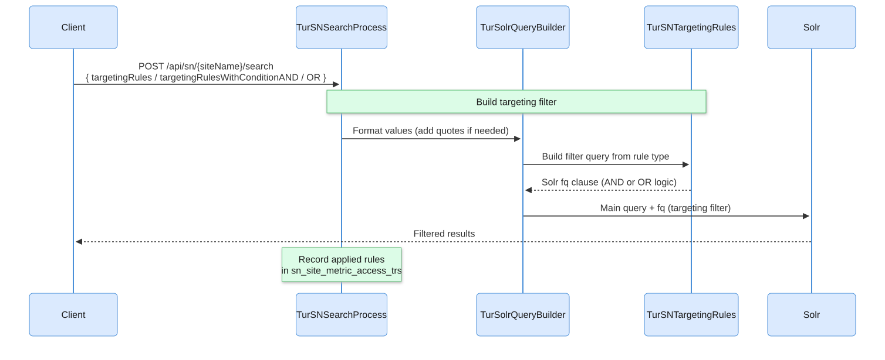

This page is for developers who show different users different results from one SN site.

Targeting rules are a search-time personalization mechanism that filters results based on user profile attributes: group, role, segment, country, department, or any indexed field. They allow different users to see different content from the same Solr index without maintaining separate cores or running multiple queries.

**There is no admin UI for Targeting Rules.** Rules are passed by the client in the body of the `POST /api/sn/{siteName}/search` request and applied dynamically at query time. The Solr schema only needs to have the targeting attributes indexed on the documents.

Common use cases:

- Corporate portal: show HR documents only to employees in the HR department
- E-commerce: show promotions for the user's country and loyalty segment
- Intranet: restrict confidential documents to users with the correct access group
- SaaS platform: filter documentation by the user's subscription tier

## How the pipeline works



## Four rule types

Targeting Rules are sent in the POST request body (see [POST Body Parameters](/docs/rest-api/#post-body-parameters)). The four types differ in how values are combined across attributes:

### `targetingRules`: a simple list

A flat array of `attribute:value` strings. Values for the **same attribute** are combined with **OR**; different attributes are combined with **AND**.

```json
{
  "query": "benefits",
  "targetingRules": ["department:HR", "department:Finance", "clearance:confidential"]
}
```

Result: documents where `(department=HR OR department=Finance)` AND `(clearance=confidential OR no clearance)`.

### `targetingRulesWithCondition`: a map with the default logic

A map of `attribute → list of values`. Behaves identically to `targetingRules` but uses a structured map format instead of a flat list. Values for the **same attribute** are combined with **OR**; different attributes are combined with **AND**.

```json
{
  "query": "benefits",
  "targetingRulesWithCondition": {
    "department": ["HR", "Finance"],
    "clearance": ["confidential"]
  }
}
```

Result: equivalent to the `targetingRules` example above: `(department=HR OR department=Finance)` AND `(clearance=confidential OR no clearance)`.

### `targetingRulesWithConditionAND`: explicit AND

A map of `attribute → list of values`. Every attribute group must be satisfied simultaneously, AND between groups, OR within each group.

```json
{
  "query": "promotions",
  "targetingRulesWithConditionAND": {
    "country": ["BR"],
    "language": ["pt"]
  }
}
```

Result: documents matching `country=BR` **AND** `language=pt` (or documents with no restrictions on either attribute).

### `targetingRulesWithConditionOR`: explicit OR

A map of `attribute → list of values`. Any condition is sufficient, OR across all groups.

```json
{
  "query": "discount",
  "targetingRulesWithConditionOR": {
    "segment": ["premium", "gold"],
    "loyalty": ["active"]
  }
}
```

Result: documents matching any of the conditions: `segment=premium`, `segment=gold`, or `loyalty=active`. More permissive than AND.

## How rules become filter queries

Viglet Turing converts the rule type into Solr `fq` clauses automatically.

**AND logic** (each attribute group becomes a clause, all clauses joined with AND):

```text
(group:admin OR group:user OR (*:* NOT group:*))
AND
(role:editor OR (*:* NOT role:*))
```

Each clause includes `(*:* NOT attribute:*)`: documents that are not tagged with the attribute are always included (the fallback clause). This ensures untagged, unrestricted content is always visible regardless of the active rules.

**OR logic** (all attribute-value pairs flattened, joined with OR):

```text
(attr1:val1 OR attr2:val2)
OR
(*:* NOT attr1:* AND NOT attr2:*)
```

Documents that have none of the targeting attributes are also included.

## The fallback clause

Both AND and OR methods include `(*:* NOT attribute:*)` to ensure documents that were never tagged with a targeting attribute are always returned. This means:

- Adding targeting rules to a search request does **not** hide untagged content
- Only documents explicitly tagged with a **conflicting** attribute value are filtered out
- Documents with no targeting attributes are always visible

## Practical examples

### Example 1: Corporate portal with department-scoped content

```json
POST /api/sn/portal/search
{
  "query": "benefits",
  "targetingRules": ["department:HR", "department:Finance"]
}
```

Returns documents tagged for HR or Finance departments, plus all untagged public documents. A Marketing employee does not see HR-restricted content.

### Example 2: E-commerce by country and language (AND)

```json
{
  "query": "promotions",
  "targetingRulesWithConditionAND": {
    "country": ["BR"],
    "language": ["pt"]
  }
}
```

Solr `fq`: `(country:BR OR (*:* NOT country:*)) AND (language:pt OR (*:* NOT language:*))`

Returns only documents for Brazil **and** in Portuguese, plus documents with no country or language restriction. A document tagged `country:US` is filtered out.

### Example 3: Internal system with role and group (AND)

```json
{
  "query": "reports",
  "targetingRulesWithConditionAND": {
    "role": ["admin", "manager"],
    "group": ["sales"]
  }
}
```

Solr `fq`: `(role:admin OR role:manager OR (*:* NOT role:*)) AND (group:sales OR (*:* NOT group:*))`

Documents visible to admins or managers (or no role restriction), and within the sales group (or no group restriction).

### Example 4: Promotional content by segment (OR)

```json
{
  "query": "discount",
  "targetingRulesWithConditionOR": {
    "segment": ["premium", "gold"],
    "loyalty": ["active"]
  }
}
```

Returns documents matching any condition: premium, gold, or active loyalty. More permissive than AND; used when any segment match is sufficient.

### Example 5: Intranet with access group control

```json
{
  "query": "security policy",
  "targetingRules": ["access_group:it", "access_group:security", "clearance:confidential"]
}
```

Returns documents accessible to IT or Security groups, AND with clearance=confidential (or no clearance). Documents tagged `access_group:directors` remain hidden.

## Indexing requirements

The targeting attributes must be **indexed fields** in the Solr schema and **populated at indexing time** by the Viglet Dumont connector. Add the desired targeting fields to the SN Site's Fields configuration so they are included in the schema.

If a document is indexed without a targeting attribute (the field is absent or empty), it is treated as unrestricted and always visible, the fallback clause ensures this.

## Metrics

Every search request with targeting rules is recorded in the site's metrics, so you can see which rule combinations were applied, how often, and how they affected the number of results.

## Related pages

| Page | What it covers |
|---|---|
| [Semantic Navigation](/docs/semantic-navigation/) | The SN site settings and fields the attributes are indexed into |
| [REST API](/docs/rest-api/#post-body-parameters) | The search request body that carries the rules |
| [Search rules](/docs/search-rules/) | Rules the site applies on its own, from conditions on the request |
