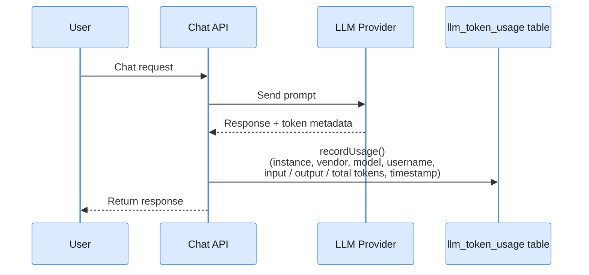

If you are an administrator responsible for monitoring AI spend, this page is for you. Token Usage helps you track how much each LLM model is costing your organization by showing consumption broken down by model, day, and month, so you can identify heavy usage patterns, set budgets, and avoid unexpected bills.

The **Token Usage** page (`/token-usage`) gives administrators a clear view of how many tokens are being consumed by the LLM integrations: broken down by model, day, and month. This is the primary tool for tracking AI costs and identifying heavy usage patterns.

:::note[Availability]
This page only appears in the sidebar when **at least one LLM instance is enabled**. If no LLM is configured, the Generative AI section will not show Token Usage.
:::

:::tip[Tokens vs. dollars]
Token Usage shows **counts**: how many tokens each model consumed. To see those tokens turned into **USD spend** (with an editable price table, per-agent/model/stage breakdowns, and soft budget caps), use [Cost Governance](/docs/cost-governance/). Both read the same always-on `llm_token_usage` table.
:::

---

## Period Selector

At the top of the page, a month navigator lets you move forward and backward through calendar months. All cards and tables update instantly when the period changes.

```
◀  January 2025  ▶
```

---

## Summary Cards

Four cards provide an at-a-glance snapshot of the selected month:

| Card | Description |
|---|---|
| **Total Requests** | Number of LLM API calls made during the period |
| **Input Tokens** | Total tokens sent to the model (prompts, context, system messages) |
| **Output Tokens** | Total tokens received from the model (generated responses) |
| **Total Tokens** | Sum of input + output tokens |

Values are displayed in a human-readable format (for example `1.2M`, `45K`, or `8.3K`) rather than raw numbers.

---

## Summary by Model

A monthly aggregation table grouping consumption by LLM instance:

| Column | Description |
|---|---|
| **Instance** | The LLM instance name as configured in Administration |
| **Vendor** | Provider (e.g., OpenAI, Anthropic, Google, Azure, Ollama) |
| **Model** | Specific model identifier (e.g., `gpt-4o`, `claude-3-5-sonnet`) |
| **Requests** | Total requests to this instance in the period |
| **Input** | Total input tokens for this instance |
| **Output** | Total output tokens for this instance |
| **Total** | Combined token count for this instance |

Use this table to compare token consumption across different providers and models, and to identify which instances account for the largest share of usage.

---

## Daily Breakdown

A day-by-day table showing consumption per model across the selected month:

| Column | Description |
|---|---|
| **Date** | Calendar day |
| **Instance** | LLM instance name |
| **Vendor** | Provider |
| **Model** | Model identifier |
| **Input Tokens** | Tokens sent that day |
| **Output Tokens** | Tokens received that day |
| **Total Tokens** | Combined token count for that day |
| **Requests** | Number of requests on that day |

Days with no LLM activity do not appear in the table. This breakdown helps spot daily spikes, for example, a batch re-indexing job or a high-traffic event.

---

## How Token Recording Works

Viglet Turing records token usage automatically on every LLM call: no extra configuration is needed.



**What gets recorded on each call:**

| Field | Description |
|---|---|
| Instance | Which LLM instance handled the request |
| Vendor | Provider name |
| Model | Model identifier from the response metadata |
| Username | The authenticated user who triggered the call |
| Input Tokens | Extracted from the LLM response metadata |
| Output Tokens | Extracted from the LLM response metadata |
| Total Tokens | Input + output |
| Timestamp | Date and time of the request |

:::note
Responses where all token counts are zero are **not recorded**. This filters out failed or incomplete LLM calls that would skew usage statistics.
:::

The same `llm_token_usage` row also carries a frozen **`cost_usd`** plus the originating **agent** and cost **stage** (`chat.live` / `chat.background` / `chat.skill`), which is what powers [Cost Governance](/docs/cost-governance/). One table, two views.

---

## API Endpoint

Token usage data is also available via the REST API. See [REST API Reference → Token Usage API](/docs/rest-api/#token-usage-api) for endpoint details and examples.

---

## Related Pages

| Page | Description |
|---|---|
| [Cost Governance](/docs/cost-governance/) | The USD-spend layer on top of these token counts |
| [LLM Instances](/docs/llm-instances/) | The models whose consumption is tracked here |
| [Observability](/docs/observability/) | Token/cost metrics in Prometheus + Grafana |

---


